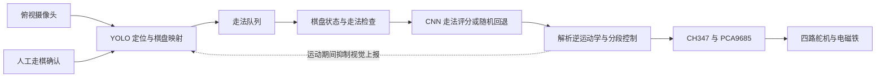

# ChessRobot

基于机器视觉与电磁抓放的四自由度中国象棋机器人。

**简体中文** · [English](README_EN.md) · [日本語](README_JA.md)

**深入阅读：**[四代视觉与算法](docs/technical-notes.zh-CN.md#vision-history) · [数学模型](docs/technical-notes.zh-CN.md#mathematical-models) · [实机图集](docs/technical-notes.zh-CN.md#hardware-gallery) · [部署与操作](docs/setup.zh-CN.md)

ChessRobot，又名“智弈·灵手”，是由四人团队完成的本科机器人课程项目。俯视摄像头检测人类走棋，软件棋盘选择应手，四关节机械臂通过电磁铁搬运棋子。项目探索了视觉感知、棋局状态与实体运动在桌面场景中的协同。

课程原型采用**人工确认走棋**。视觉方案从霍夫圆与字符分类逐步演进为 YOLO 定位和时序稳定流程；结合棋盘自动校正与网格分类的第四代方案正在开发，目标是识别任意中残局。


[观看完整实机演示](https://www.bilibili.com/video/BV1aXLn6HEQd)。视频记录课程原型，不代表第四代已完成整机集成，也不作为通用识别准确率的证明。

## 系统架构



图像处理和调度运行于 Windows PC。CH347 USB 桥接芯片连接 PCA9685 舵机驱动板及继电器控制接口。USB 摄像头观察 35 × 35 cm 米黄色软质棋盘，配合 32 枚直径约 30 mm 的手工导磁棋子。几何参数、标定值和补偿系数均针对这套原型硬件。

## 核心工程设计

**视觉与数据。** 主流程通过四点单应性变换，将棋子检测中心映射到 10 × 9 棋盘。ROI 掩膜、局部对比度增强、中心点平滑与轨迹历史投票用于减轻背景和检测波动的影响。棋子身份由标准开局及历史走法维持，当前检测器不独立识别每个棋子的汉字。人类走棋后按空格键提交当前盘面。

**运动控制。** 几何解析逆运动学把目标坐标转换为四关节指令，配合横向、径向及高度经验补偿修正落点。分段垂直吸取、盘面上方 8 mm 微距接近及安全高度转移，用于减少对相邻棋子的碰撞。笛卡尔插补按名义 50 Hz 调度，实际时序受主机与硬件影响；当前程序没有读取关节位置或末端落点来闭环修正动作。

**棋局与协同。** 规则模块保存盘面、检查棋子运动约束并枚举候选走法。PyTorch CNN 对 8,100 个起终点组合评分，在规则模块返回的候选集合中选择走法；缺少 `game/aaa.pth` 时随机选择候选走法。主程序通过队列协调视觉与动作，并在机械臂运动期间抑制视觉走法上报。当前规则实现不等同于完整的竞赛级裁判系统。

## 四代视觉演进

| 阶段 | 方法与工作 | 主要发现及状态 |
| :--- | :--- | :--- |
| **第一代：圆检测与字符分类** | 霍夫圆定位、颜色分析，以及使用合成字模训练的灰度 ResNet-18 字符分类。 | 历史原型。光照、字符裁剪分辨率及合成到真实图像的差异限制了实机识别。 |
| **第二代：多类别 YOLO** | 实拍采集、手工标注与 14 类棋子检测微调。团队记录包括原绿色棋盘约 500 张、更换米色棋盘后约 120 张图像。 | 历史实验。棋盘更换带来背景域变化，相似汉字仍难稳定区分。 |
| **第三代：定位与状态跟踪** | 单类棋子定位、单应性映射、轨迹稳定与人工确认后的盘面差分。 | 当前整机入口使用的流程。完成课程演示，依赖标准开局初始化和人工确认。 |
| **第四代：校正后的网格分类** | 四角点姿态估计、透视归一化、合成棋盘数据及 Swin 网络，对 90 个交点进行 16 状态分类。 | 开发中。项目专用训练、评估及整机集成仍是后续节点，本页不报告该方案在本机器上的准确率。 |

这条演进主线是从识别局部字符，转向估计结构化棋盘。第三代优先保证课程原型可演示；第四代目标是直接恢复棋子身份，支持中盘与残局。各代算法、历史试验与当前代码的对应关系见[技术说明](docs/technical-notes.zh-CN.md)。

## 团队贡献

| 成员 | 主要职责 | 工作内容 |
| :--- | :--- | :--- |
| **田峻硕 / Tian Junshuo** | 组长、机械与运动控制 | 机械臂装配、底层驱动、逆运动学及抓放转移控制。 |
| **刘超然 / Chaoran Liu** | 视觉感知 | 独立完成视觉实拍数据采集与标注；主导视觉试验与迭代，制作棋盘及导磁棋子，开发 GUI 原型，协同调试运动补偿参数，并推进第四代视觉方案。 |
| **张子琛 / Zichen Zhang** | 规则与走棋决策 | 棋盘表示、棋子运动规则及 PyTorch 走法选择模块。 |
| **邢义龙 / Yilong Xing** | 系统集成与工装 | 电气布线、供电分配、末端执行器夹具及硬件联调支持。 |

项目报告、演示文稿和答辩汇报由四人分工完成。模块分工用于说明个人贡献与团队整机成果之间的关系。

## 验证结果与当前范围

| 依据 | 观察结果 | 适用范围 |
| :--- | :--- | :--- |
| 团队记录的落子试验 | **连续 20 步走棋中，18 次棋子覆盖目标交叉中心点**，2 次存在偏移。 | 本次小样本中心覆盖率为 90%；不等同于毫米级位置误差、视觉准确率或整场对局成功率。 |
| 实机演示视频 | 展示电磁吸取、转移、放置与复位动作。 | 记录课程原型，未构成受控的视觉识别评测。 |
| 视觉数据采集 | 团队记录共 620 张标注实拍图，包含两种棋盘背景。 | 用于说明数据准备工作，不代表模型准确率；完整训练原图未随仓库发布。 |
| 第四代识别 | 已说明开发方法与目标。 | 暂不报告该方案在本机器人上的独立实测指标。 |

当前流程需要四点标定；自动判向失败时需手动选择朝向，走棋需人工确认。吃子可能造成跟踪 ID 混淆，颜色自动判向存在实现问题，GUI 也需要补齐部分接口。相关边界以及演示硬件与当前配置的区别见[技术说明](docs/technical-notes.zh-CN.md)。

## 快速开始

整机入口面向 Windows 10/11、64 位 Python 3.10+、支持 CUDA 的 PyTorch 环境与已连接的实体硬件。`requirements.txt` 给出依赖版本下限，并非经过锁定验证的完整环境。

```powershell
git clone https://github.com/TJS-Git-Hub/ChessRobot.git
cd ChessRobot
python -m pip install -r requirements.txt
```

准备 WCH 驱动与 `CH347DLLA64.DLL`，核对设备和标定参数，并确认 `recognition/models/best.pt` 与检测流程匹配。可选决策权重路径为 `game/aaa.pth`。不能仅凭模型文件名判断其类别或训练来源。

```powershell
python main.py
```

控制器初始化会驱动机械臂返回待命位置，应先完成接线和运动空间检查。标定、按键操作、GUI 状态、外部文件与故障排查见[部署与操作指南](docs/setup.zh-CN.md)。

## 后续开发与文档

- **视觉：**准备本项目棋子切片与空盘图像，训练并评估校正后的网格分类器，再接入机器人状态更新；评测覆盖吃子、局部遮挡、偏离交点的棋子和残局。
- **运动：**使可达性计算与实际标定一致，开展覆盖不同棋盘区域的重复落子试验，并研究更平滑的加减速轨迹。
- **决策与集成：**验证走法约束和权重加载行为，补齐 GUI 接口，并在明确基线下评估后续决策改进。

[技术说明](docs/technical-notes.zh-CN.md)记录算法、代码依据、结果与研发状态；[部署与操作指南](docs/setup.zh-CN.md)记录依赖及运行流程。两类文档均提供中、英、日语言切换。

仓库代码采用 [MIT 许可证](LICENSE)。项目使用 Ultralytics YOLO、OpenCV、PyTorch、PyQt5 与 WCH 硬件接口。第四代研究也参考 OpenMMLab 和相关中国象棋识别实现，具体来源列于技术说明；第三方组件各自遵循其许可证。
