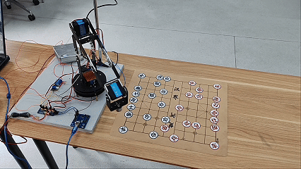
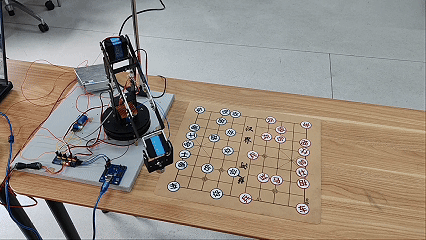
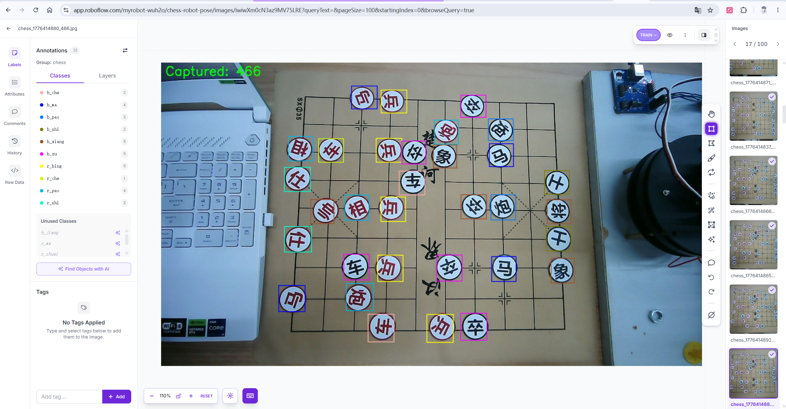
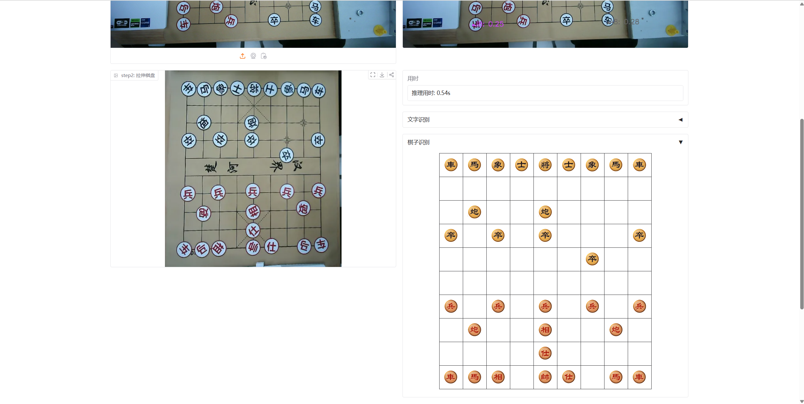

<div align="center">

# 基于机器视觉与深度学习的四自由度中国象棋对弈机器人系统
### Autonomous 4-DOF Chinese Chess Robotic Arm System with Deep Vision & Kinematics

[ English ](README_EN.md) | [ 简体中文 ](README.md) | [ 日本語 ](README_JA.md)

<br/>

[](https://www.python.org/)
[-ee4c2c.svg?style=for-the-badge&logo=pytorch)](https://pytorch.org/)
[](https://ultralytics.com/)
[](https://opencv.org/)
[](https://github.com/)
[](https://www.bilibili.com/video/BV1aXLn6HEQd)
[](LICENSE)

<p align="center">
  本项目是由团队自主研发的<b>四自由度（4-DOF）中国象棋人机对弈机器人系统</b>（代号“智弈·灵手”）。<br/>
  系统通过俯视工业摄像头实时捕获人类走棋，经透视单应性变换解算物理网格坐标并传输至博弈决策大脑；<br/>
  决策模型完成走法推演后，驱动四自由度关节型机械臂执行开环空间轨迹规划，<br/>
  利用末端电磁吸盘实现棋子的精准拾取、五阶段微距防碰撞转移与平稳落子。
</p>

</div>

---

## 目录
- [1. 系统概述与硬件工装制作](#1-系统概述与硬件工装制作)
- [2. 团队职责分工](#2-团队职责分工)
- [3. 硬件实机演示与落子精度](#3-硬件实机演示与落子精度)
- [4. 系统模块架构与算法演进](#4-系统模块架构与算法演进)
  - [4.1 机械与运动控制模块 (田峻硕负责，刘超然辅助调试)](#41-机械与运动控制模块-田峻硕负责刘超然辅助调试)
  - [4.2 视觉感知模块及四代演进历程 (刘超然独立负责)](#42-视觉感知模块及四代演进历程-刘超然独立负责)
  - [4.3 博弈决策与规则引擎模块 (张子琛负责)](#43-博弈决策与规则引擎模块-张子琛负责)
- [5. 硬件电气连接与总线定义](#5-硬件电气连接与总线定义)
- [6. 仓库代码目录规范](#6-仓库代码目录规范)
- [7. 快速复现与部署运行指南](#7-快速复现与部署运行指南)
- [8. 系统操作指南（对弈交互与标定）](#8-系统操作指南对弈交互与标定)
- [9. 开源许可与致谢](#9-开源许可与致谢)

---

## 1. 系统概述与硬件工装制作

本项目构建了一套兼具桌面便携性与高稳定性的实体对弈机器人平台，由团队成员自主设计、装配、制作与编程实现。

### 1.1 实体棋盘与棋子制作细节
- **定制棋盘**：选用规格为 $35 \times 35\,\text{cm}$ 的米黄色中国象棋软质便携棋盘（软盘），表面纹理清晰，反光适中，网格线宽精准。
- **纯手工自制导磁棋子**：
  - 选用标准加粗微软雅黑字体设计红黑双方共 32 枚棋子图案，严格设定圆形图纸直径为 $3.0\,\text{cm}$；
  - 打印图纸后逐个手工精准裁剪；
  - 采购直径为 $3.0\,\text{cm}$、厚度适中的圆形金属导磁铁片，将裁剪好的字贴平整粘贴在铁片正面，制成专用的导磁象棋棋子。
- **末端执行机构与抓取方式**：
  - 机械臂末端配备 5V 直流吸盘电磁铁，通过板载继电器进行通断电控制；
  - 吸取棋子时，机械臂垂直下探至棋子上方，继电器吸合通电，电磁铁牢固吸附棋子铁片；
  - 到达目标格点后，继电器断开消磁，棋子平稳释放就位。

### 1.2 实测对弈精度与考核指标
运动控制的核心指标在于**轨迹防刮蹭避碰**以及**棋子在目标网格交叉中心点的覆盖度**。  
在系统的连续 20 步实机走棋测试中：
- **18 次精准覆盖** 棋盘网格交叉中心点；
- **仅 2 次微偏** 未完全居中覆盖；
- **落子中心覆盖成功率达到 90%**，整机运行平稳流畅，无碰倒相邻棋子现象。

---

## 2. 团队职责分工

项目的软硬件研发由四位成员紧密配合完成。答辩汇报、演示文稿设计与项目技术设计报告均由四位成员分工协作、共同撰写与现场汇报。

| 成员 | 团队工程角色 | 核心研发模块与技术落地 |
| :--- | :--- | :--- |
| **田峻硕 (Tian Junshuo)** | **团队组长 / 机械与运动控制负责人** | <ul><li>负责四自由度机械臂硬件结构装配、舵机选型与各关节调试；</li><li>负责 WCH CH347 USB 桥接与 PCA9685 12-bit PWM 底层驱动实现（`hardware.py`）；</li><li>推导空间几何解析逆运动学（Analytical IK）闭式解（`kinematics.py`）；</li><li>设计微距空间五阶段防刮蹭无碰撞抓放轨迹规划控制律（`control.py`）。</li></ul> |
| **刘超然 (Liu Chaoran)** | **视觉感知负责人** | <ul><li><b>独立完成视觉系统所有真实图像数据集的采集、清洗、手工标注以及四代算法演进研发</b>；</li><li><b>自主设计并制作专用棋盘工装与 32 枚导磁贴片棋子</b>；</li><li>研发第四代全自主空间感知网络：实现四角点自动透视校正与畸变拉平，训练 Swin-Transformer 全局特征网络直接输出 $10 \times 9 \times 16$ 空间状态张量，完成全盘 90 个交叉点的高精度 16 分类；</li><li>开发 PyQt5 异步多线程人机交互控制台（`ui_main.py`）；</li><li><b>辅助参与机械臂运动控制参数的工程调试</b>（包括悬臂重力下垂的高度补偿参数调谐等）。</li></ul> |
| **张子琛 (Zhang Zichen)** | **博弈决策与规则引擎负责人** | <ul><li>负责中国象棋 10x9 完整棋盘走法规则引擎构建与历史回滚机制（`game/board.py`）；</li><li>研发基于 PyTorch 深度卷积神经网络（`ChessNet`，14通道输入/8100维输出）的局面评估与走子决策模型（`game/ai.py`）；</li><li>定义棋盘网格空间坐标映射与标准初始棋局常量（`game/constants.py`）。</li></ul> |
| **邢艺龙 (Xing Yilong)** | **系统集成与工装搭建** | <ul><li>负责整机电气布线、电源稳压配电箱搭建与接线规范管理；</li><li>制作机械臂末端电磁铁机械夹具并完成装配固定；</li><li>搭建多轴硬件测试台架，辅助开展多轴联合调试与动作可靠性验证（`tools/`）。</li></ul> |

---

## 3. 硬件实机演示与落子精度

实机动态对弈全流程演示视频已发布在 Bilibili，涵盖人类走子、视觉坐标映射、AI决策解算、4轴机械臂轨迹转移与电磁精准拾放的全过程：

👉 **[点击观看 Bilibili 完整实录：四自由度象棋对弈机器人端到端实操](https://www.bilibili.com/video/BV1aXLn6HEQd)**

### 3.1 实机运行动态实录 (Live Gameplay GIFs)

<div align="center">

| 动态实录 1：机械臂高位平移与垂直吸取 | 动态实录 2：防碰撞轨迹转移与精准落子 |
| :---: | :---: |
|  |  |
| 接收到走法后，机械臂从待命点出发，垂直对准棋子并通电吸附 | 抬升至安全巡航平面，平移至目标点垂直落子断电，实现 90% 中心覆盖率 |

</div>

### 3.2 实机对弈高清实录原图

<div align="center">

| 现场高清对弈图 1：电磁垂直吸附 (`demo_live_arm_pickup.jpg`) | 现场高清对弈图 2：目标点精准释放 (`demo_live_arm_place.jpg`) |
| :---: | :---: |
|  |  |

</div>

---

## 4. 系统模块架构与算法演进

系统划分为三大核心模块：**机械与运动控制模块**、**视觉感知模块**、**博弈决策与规则引擎模块**。

---

### 4.1 机械与运动控制模块 (田峻硕负责，刘超然辅助调试)

机械臂采用四自由度关节型串联构型：底座水平回转关节（J1）、大臂俯仰关节（J2）、小臂俯仰关节（J3）与腕部姿态保持关节（J4），末端挂载微型电磁铁吸盘（强制保持垂直向下 $\phi = -90^\circ$）。

#### 1. 物理连杆几何参数 (`config.py`)
- 底座回转中心高： $L_1 = 73.0\,\text{mm}$
- 大臂有效连杆长： $L_2 = 231.0\,\text{mm}$
- 小臂有效连杆长： $L_3 = 231.0\,\text{mm}$
- 腕部关节至吸盘端长： $L_4 = 66.0\,\text{mm}$

#### 2. 非线性机械形变与前馈补偿模型 (`kinematics.py`)
由于开环数码舵机传动齿隙与长力臂在重力作用下的弹性形变，系统引入前馈补偿控制律：

**1. X 轴横向几何比例放大前馈**：

$$
X_{\text{comp}} = X \times K_x \quad (K_x = 1.125)
$$

**2. 合成工作半径与伸展修正**：

$$
R_{\text{target}} = \sqrt{X_{\text{comp}}^2 + Y^2}, \quad R_{\text{comp}} = R_{\text{target}} \times (1 - K_r) \quad (K_r = 0.06)
$$

**3. 悬臂自重弹性下垂垂度补偿**：

$$
\text{comp}_z = Z + (R_{\text{target}} \times K_z) \quad (K_z = 0.12)
$$

#### 3. 几何解析逆运动学求解
在腕部强制保持垂直向下的约束下，将空间三维运动解耦至俯仰平面求解：

**步骤 1：底座回转角**（求解航向角 $\theta_1$ 并映射至舵机基准角 $t_1^{\text{deg}}$）

$$
\theta_1 = \text{atan2}(X_{\text{comp}}, Y), \quad t_1^{\text{deg}} = \text{degrees}(\theta_1) + 90.0^\circ
$$

**步骤 2：俯仰高度差与连杆弦长**

$$
\Delta Z = (\text{comp}_z + L_4) - L_1, \quad D = \sqrt{R_{\text{comp}}^2 + \Delta Z^2}
$$

**步骤 3：余弦定理求大臂内角** $\alpha$ **与小臂内角** $\gamma$

$$
\cos(\alpha) = \frac{L_2^2 + D^2 - L_3^2}{2 L_2 D}, \quad \cos(\gamma) = \frac{L_2^2 + L_3^2 - D^2}{2 L_2 L_3}
$$

**步骤 4：关节角求解**

$$
\beta = \text{atan2}(\Delta Z, R_{\text{comp}})
$$

$$
t_2^{\text{deg}} = \text{degrees}(\beta + \alpha), \quad t_3^{\text{deg}} = t_2^{\text{deg}} - (180.0^\circ - \text{degrees}(\gamma)), \quad t_4^{\text{relative}} = -90.0^\circ - t_3^{\text{deg}}
$$

#### 4. 微距五阶段防刮蹭轨迹规划 (`control.py`)
为防止吸盘斜向运动碰倒相邻紧密排列的棋子，运动轨迹严格规划为五阶段航路点：
- **平移至上方**：快速平移至棋子正上方安全巡航高度 $Z_{\text{safe}} = 70.0\,\text{mm}$ ；
- **降至微距缓冲**：垂直降至距棋子表面上方 8mm 处悬停（ $Z_{\text{micro}} = -25.0\,\text{mm}$ ），等待手腕姿态稳定调平；
- **慢速垂直切入吸附**：慢速下探至盘面 $Z_{\text{board}} = -33.0\,\text{mm}$ ，继电器导通电磁铁吸起棋子，延时 0.5s；
- **小臂主导纯垂直微抬**：纯垂直抬升 8mm 回到 $Z_{\text{micro}}$ ，彻底杜绝侧向摆动带倒邻子；
- **升至巡航高度**：垂直拉升至 $Z_{\text{safe}}$ 后平移至目标点，并在目标点执行相同的微距垂直下探释放动作。

#### 5. 机械与运动控制的未来优化方向
下一步将重点优化多轴插补轨迹算法，引入 S 曲线平滑加减速控制，进一步抑制远端机械抖动，确保复杂长距离移位时末端落点更加平稳。

---

### 4.2 视觉感知模块及四代演进历程 (刘超然独立负责)

视觉模块由刘超然独立负责全部数据集采集、数据标注以及算法研发。整个视觉方案历经四代迭代与工程试错：

#### 第一代原型 (Gen 1: 霍夫圆检测 + 合成字模 OCR 探索)
- **方案构想**：利用 OpenCV 霍夫圆变换（Hough Circles）定位棋子圆形外框与圆心坐标；使用电脑脚本自动生成 Microsoft 微软雅黑加粗字体的白底红/黑字图 1000 余张，试图训练轻量级 CNN 字符识别模型进行二阶段 OCR。
- **内部两次试错迭代与局限分析**：
  - **子代 1（CNN 同步识色与识字）**：最初试图训练一个 CNN 模型同时输出红黑阵营分类与汉字类别，但实测发现在复杂光照与镜头畸变下，红黑颜色的色彩特征区分度极低，模型完全无法稳定收敛；
  - **子代 2（HSV 颜色空间解耦 + CNN 单独识字）**：随后进行任务解耦，将红黑分类剥离并改用 HSV 颜色空间进行检测（HSV 实测阵营分类效果良好），CNN 仅专注于汉字识别。
- **彻底废弃的客观根因**：
  - **字符识别完全失效**：训练集完全依赖电脑生成的微软雅黑理想字模，**缺乏真实实拍样本**，模型泛化能力极其脆弱；
  - **远端小尺度严重失真**：摄像头需俯瞰全盘因而架设位置较高，截取出的单个霍夫圆棋子分辨率极低，汉字笔画严重模糊丢失，完全无法对齐；
  - **定位灵敏度极难调谐**：霍夫圆对环境光反射极度敏感，调低则暗光漏检，调高则棋盘反光点满屏伪圆。在未进入机械臂联调的纯视觉验证阶段，该方案便因识别率过低而被果断废弃。

#### 第二代演进 (Gen 2: YOLOv11 细粒度 14 类目标检测)
- **方案构想**：放弃传统几何算子，转向深度学习。自拍 620 张覆盖多光照、多角度、空盘、对弈半程及局部遮挡的真实棋盘图像；在 **Roboflow** 平台上逐张手工标注 14 类兵种矩形框（每张 32 颗棋子），导出后在本地 **RTX 4060** 显卡上微调训练 YOLOv11n 模型（70% 训练集，20% 验证集，10% 测试集）。
- **实战表现与工程局限**：
  - **目标定位极佳**：棋子的目标检出率与圆心定位精度大幅跃升，彻底杜绝了霍夫圆漏检与假圆问题；
  - **字形分类错误率过高的物理根因**：**当时尚未引入棋盘正投影拉伸标准化（缺少单应性透视展开矫正）**。实验中摄像头手持或架设忽高忽低、距离远且带有倾角，棋子缺乏统一的物理尺度基准与正投影朝向。远端小尺寸棋子的笔画细节严重压缩丢失，极为相似的汉字（如**“車”与“卒”、“馬”与“兵”**）混淆极其严重，仅少数特征极显著的汉字能被正确识别。由于单字分类容错率为零，该模型无法直接用于对弈决策。

<div align="center">
  
  <p><b>第二代视觉研发实录：在 Roboflow 平台上逐张标注真实中国象棋对弈数据集（共 620 张图像，人工标注 14 类棋子兵种目标框）</b></p>
</div>

#### 第三代实战 (Gen 3: 战略性降维 —— YOLO 定位 + 红黑阵营二分类)
- **工程减法与正向成果**：
  - 面对工期压力与未拉伸字形细分的物理瓶颈，做出果断取舍：放弃复杂的 14 类字形识别，将 YOLO 任务降维为**“棋子位置检测 + 红黑阵营二分类”**；
  - 数据集仅需标注“红”、“黑”两类阵营目标框，训练收敛极快，**目标定位与红黑分类在实战对弈中精度极高、错误率极低**；
  - 结合单应性透视变换（Homography）将中心点实时映射至棋盘 10×9 物理网格，视觉仅将移动前后的唯一坐标差分（如 `e6 -> e4`）传递给决策大脑。
- **吃子死锁与半自动交互妥协**：
  - **吃子破坏滑动窗口稳态判定**：原算法依赖盘上全量 32 颗棋子作为滑动窗口稳态判定的守恒基准。一旦发生吃子，场上总数永久变为 31 颗，系统无法自动分辨是“棋子被吃”还是“人手遮挡”，破坏了稳态判定逻辑；
  - **人机协同状态机**：最终在 UI 界面引入**“玩家走棋确认按钮 / 空格键”**机制（按键 `1` 设黑方在上，按键 `2` 设黑方在下）。玩家走完棋并将手移开后，按下确认键触发比对，在无遮挡瞬间提取位移。该妥协确保了交付验收时 100% 动作可靠，但留下了**无法识别残局与任意局面**（必须从标准 32 颗开局起步）以及**依赖人工按键（半自动）**的两大妥协。

#### 第四代升级 (Gen 4: 全局自研范式突破 —— 全局网格张量分类)
- **自主研发与范式重构**：
  在深入查阅前沿计算机视觉文献与姿态估计范式后，视觉系统全面重构并自主研发了第四代空间感知网络：
  - **四角点自动透视校正与畸变拉平**：研发关键点检测与自动几何矫正算法，自动捕捉棋盘四个物理基准角点，无需人工手动选点标定，将斜视视角自动展开拉伸为无畸变的标准正投影俯视图；
  - **Swin-Transformer 全局特征张量分类**：彻底抛弃局部单框检测逻辑，自研训练 Swin-Transformer 全局特征网络，直接输出 $10 \times 9 \times 16$ 空间矩阵张量，一次性对棋盘全部 90 个交叉点完成 16 分类（空位 / 其它 / 红黑 14 兵种）；
  - **终极突破与闭环落地**：识别准确度极高、错误率极低，**彻底攻克残局与任意局面摆盘识别**；格子状态变更即刻捕获，**天然免疫吃子计数死锁**，完全免除人机确认按钮，真正实现了 100% 全自主感知闭环！

<div align="center">
  
  <p><b>第四代视觉实测界面：棋盘透视变换矫正（左侧 Step 2 拉伸棋盘）与 10×9 全盘网格状态识别推理结果（右侧单帧推理耗时 0.54s，实现全自动阵面数字化映射）</b></p>
</div>

---

### 4.3 博弈决策与规则引擎模块 (张子琛负责)

#### 1. 规则引擎与走法生成 (`game/board.py`)
严格实现中国象棋 10x9 完整走棋规则，内置将军判定、障碍遮挡校验（车炮走直线、马别腿、相飞田塞象眼、士将九宫格约束），并具备着法推演与历史回滚机制。

#### 2. 深度学习评估决策网络 (`game/ai.py`)
- 基于 PyTorch 构建三层卷积与两层全连接的 `ChessNet`；
- 输入为当前棋盘 $14 \times 10 \times 9$ 空间特征张量（红黑各 7 类兵种二值分布），输出 8100 维动作 logits；
- 结合合法走法掩码过滤（Masked Softmax）选取最高分合法动作；若未置入预训练权重 `aaa.pth`，系统平滑降级为在候选合法着法中随机决策，保障系统健壮性。

#### 3. 下棋算法的未来优化方向
在工科展后续迭代中，决策算法将从现有的基础卷积评估全面升级为**强化学习（RL，自博弈训练）**，进一步提升中残局棋力与战术计算深度。

---

## 5. 硬件电气连接与总线定义

系统的物理硬件电气拓扑结构如下表所示：

| 硬件模组 | 物理接口 | 驱动协议 | 宿主控制引脚 | 电气特征与控制参数 |
| :--- | :--- | :--- | :--- | :--- |
| **PCA9685 舵机驱动板** | SDA / SCL | 硬件 I2C (100kHz 标准模式) | CH347 D0(SCL) / D1(SDA) | 16 通道 12 位分辨率，基准频率 50Hz ( $T = 20\,\text{ms}$ ) |
| **底座旋转舵机 (J1)** | PWM 通道 0 | 50Hz PWM 方波 | PCA9685 输出端 0 | RDS3235 金属数码舵机，水平方位角控制 |
| **大臂俯仰舵机 (J2)** | PWM 通道 4 | 50Hz PWM 方波 | PCA9685 输出端 4 | RDS3235 35kg·cm 高扭矩数码舵机，大臂抬升控制 |
| **小臂俯仰舵机 (J3)** | PWM 通道 8 | 50Hz PWM 方波 | PCA9685 输出端 8 | 20kg·cm 精密金属数码舵机，伸展半径与高度控制 |
| **腕部姿态舵机 (J4)** | PWM 通道 12 | 50Hz PWM 方波 | PCA9685 输出端 12 | 180° 金属舵机，强制保持末端吸盘垂直朝下 |
| **电磁铁继电器** | 控制信号 | CH347 原生 GPIO | CH347 GPIO2 (Pin 10 / DTR0) | 5V 继电器控制电磁铁通断，掩码 0x04 直接驱动 |
| **工业俯视摄像头** | USB 2.0 / UVC | DirectShow 协议 | PC USB 3.0 高速口 | 1280×720 @ 30 FPS，定焦低畸变镜头 |
| **WCH CH347 桥接器** | USB Type-C | 480Mbps 高速 USB | PC 宿主机 USB 口 | 硬件 USB 转 I2C/GPIO 工业桥接器 |

### PCA9685 12-Bit PWM 脉宽映射模型
PCA9685 分辨率为 12 位（4096 级计数值），在周期 $T = 20\,\text{ms}$ （50Hz）下，脉宽与寄存器 Tick 映射方程为：

$$
\text{Tick} = \left\lfloor \frac{T_{\text{pulse}}(\text{ms})}{20\,\text{ms}} \times 4096 \right\rfloor
$$

对于 RDS3235 舵机（角度 $\theta \in [0^\circ, 270^\circ]$ ，脉宽 $0.5 \sim 2.5\,\text{ms}$ ）：

$$
T_{\text{pulse}}(\theta) = 0.5\,\text{ms} + \frac{\theta}{270^\circ} \times 2.0\,\text{ms}
$$

$$
\text{Tick}(\theta) = \left\lfloor \frac{0.5 + \frac{\theta}{270} \times 2.0}{20} \times 4096 \right\rfloor = \left\lfloor 102.4 + \theta \times 1.517 \right\rfloor
$$

---

## 6. 仓库代码目录规范

```bash
ChessRobot/
├── localization/                   # 空间视觉几何校正与棋盘标定核心模块
│   ├── find_chess_new.py           # 生产级核心视觉管道 (ChessVisionV15.4: YOLO定位 + 阵营判别 + 死区过滤)
│   ├── find_chess_simple_plus.py   # 异步视频流与高灵敏度检测演进原型
│   ├── find_chess_simple.py        # 早期轻量化视觉算法测试原型 (ChessVisionV7)
│   └── find_chess.py               # 经典全分类视觉引擎历史版 (ChessVisionEngineV6)
├── recognition/                    # 模型训练、数据采集与标定参数存储
│   ├── train.py                    # YOLO 目标检测模型微调训练脚本
│   ├── collect_real_data.py        # 实机多角度多光照图像数据集采集脚本
│   ├── test_gpu.py                 # CUDA / GPU 加速与推理环境验证脚本
│   ├── yolo26n.pt                  # 迭代微调权重文件
│   └── models/                     # 标定几何参数与模型权重持久化存储 (best.pt, H_matrix.npy, ROI_corners.npy)
├── game/                           # 中国象棋博弈决策大脑与规则引擎
│   ├── board.py                    # 10x9 完整象棋物理规则基座 (合法走法生成 / 走子校验 / 局面回滚)
│   ├── ai.py                       # 基于 PyTorch 卷积神经网络的局面评估决策引擎 (ChessNet, 14通道输入/8100维输出；未置入 aaa.pth 时降级随机合法走法)
│   ├── constants.py                # 初始棋局阵型、棋盘坐标映射与网格几何常量
│   └── play.py                     # 独立终端人机对弈测试主入口
├── tools/                          # 硬件调试与底层标定工具集
│   ├── calibrate_servo.py          # 4 自由度机械臂各关节舵机零位微秒脉宽标定工具 (通道 0, 4, 8, 12)
│   ├── test_electromagnet.py       # WCH CH347 原生 GPIO2 (DTR0) 电磁铁吸附通断测试脚本
│   └── calc_reach.py               # 机械臂极限作业半径与理论可达空间几何校验脚本
├── control.py                      # 机械臂运动控制中枢 (微距空间五阶段防刮蹭抓放控制律)
├── kinematics.py                   # 4 自由度空间解析逆运动学求解器 (含 X 轴增益与重力下垂前馈模型)
├── hardware.py                     # WCH CH347 高速 USB 桥接 (100kHz I2C + GPIO2) + PCA9685 12-bit PWM 硬件驱动
├── config.py                       # 系统全局连杆物理几何尺寸 (L1-L4)、舵机通道与棋盘坐标基准
├── main.py                         # 终端命令行主程序 (基于 move_queue 的异步端到端对弈闭环)
├── ui_main.py                      # 基于 PyQt5 的异步多线程人机交互控制台 (实时视频 / 虚拟棋盘 / 标定)
├── yolo11n.pt                      # 定制微调的轻量级中国象棋检测网络权重
├── requirements.txt                # Python 依赖库环境清单
├── LICENSE                         # MIT 官方开源许可证
├── README.md                       # 简体中文系统技术规格说明书
├── README_EN.md                    # English Technical Specification
└── README_JA.md                    # 日本語技術仕様書
```

---

## 7. 快速复现与部署运行指南

### 7.1 环境依赖
- **操作系统**：Windows 10 / 11 (64-bit)
- **Python 环境**：Python 3.10+ (推荐使用 Anaconda 或 Miniconda)
- **CUDA 算力**：NVIDIA GPU (推荐 GTX 1650 / RTX 4060 及以上)
- **硬件依赖**：WCH CH347 驱动 (`CH347DLLA64.DLL`) 已内置于工程根目录

### 7.2 虚拟环境构建与依赖安装
```bash
# 1. 克隆代码仓库
git clone https://github.com/TJS-Git-Hub/ChessRobot.git
cd ChessRobot

# 2. 创建并激活 Python 3.10 隔离环境
conda create -n chess_robot python=3.10 -y
conda activate chess_robot

# 3. 安装依赖库与 PyTorch (CUDA 版本)
pip install -r requirements.txt
pip install torch torchvision --index-url https://download.pytorch.org/whl/cu118
```

### 7.3 硬件自检与调优
```bash
# 1. 调试机械臂各轴舵机零位脉宽偏置 (基准 90° 竖直姿态)
python tools/calibrate_servo.py

# 2. 测试 WCH CH347 原生 GPIO2 继电器与电磁铁吸附动作
python tools/test_electromagnet.py

# 3. 校验机械臂作业半径与理论极限可达空间
python tools/calc_reach.py
```

### 7.4 启动对弈系统
- **启动 PyQt5 全功能交互控制台**：
  ```bash
  python ui_main.py
  ```
- **启动无界面终端 CLI 模式**：
  ```bash
  python main.py
  ```

---

## 8. 系统操作指南（对弈交互与标定）

1. **四点单应性交互标定**：
   - 启动系统后，在视频画面中依次顺时针点击棋盘四个基准角点（1.左上 $\to$ 2.右上 $\to$ 3.右下 $\to$ 4.左下）；
   - 系统自动通过 SVD 分解计算单应性矩阵 $\mathbf{H}$，完成像素坐标至毫米物理坐标的无畸变映射。
2. **棋局摆放与对弈开始**：
   - 将红黑双方 32 枚自制导磁棋子摆放在米黄色棋盘标准初始位置；
   - 点击控制台界面的 `开始对弈`，系统锁定初始盘面。
3. **人类走棋与确认触发**：
   - 人类玩家执红先行走子；走子完毕并将手移开棋盘区域后，按下**键盘空格键**（或点击界面上的**走法确认**按钮）；
   - 视觉提取位移并传递坐标至 `move_queue`，算法大脑随即推算黑方最优应手。
4. **机械臂自动执行**：
   - 机械臂从待命点出发，执行五阶段微距防刮蹭轨迹：巡航到达 $\to$ 8mm微距调平 $\to$ 垂直吸取 $\to$ 垂直微抬 $\to$ 巡航平移 $\to$ 目标点垂直下探落子 $\to$ 平滑复位至待命点。

---

## 9. 开源许可与致谢

本项目依据 **[MIT License](LICENSE)** 协议开源。

- **核心工程团队**：
  - **田峻硕 (Tian Junshuo)**：团队组长、机械结构装配、底层驱动与逆运动学轨迹规划
  - **刘超然 (Liu Chaoran)**：视觉感知负责人、独立数据集采集与标注、四代视觉算法迭代研发、运动控制参数调谐与 PyQt5 交互控制台
  - **张子琛 (Zhang Zichen)**：博弈决策与规则引擎负责人、中国象棋规则引擎与 PyTorch 决策模型研发
  - **邢艺龙 (Xing Yilong)**：系统集成、电气配线管理、导磁棋盘与电磁铁硬件工装组装
- **项目成果汇报**：答辩现场汇报、PPT 文稿设计与技术设计报告由全组四位成员共同协作完成。
- **致谢**：感谢 Ultralytics YOLO、OpenCV、OpenMMLab 与 WCH 开源技术社区的支持。

<div align="center">
  <b>ChessRobot — 智弈·灵手</b>，融合现代计算机视觉与多轴精密控制的中国象棋对弈系统。
</div>
