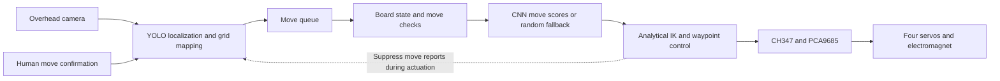

# ChessRobot

A 4-DOF Chinese chess robot with camera-based perception and electromagnetic pick-and-place.

[简体中文](README.md) · **English** · [日本語](README_JA.md)

**Explore the implementation:** [Vision](docs/technical-notes.en.md#vision-history) · [Motion control](docs/technical-notes.en.md#motion-hardware) · [Game decision](docs/technical-notes.en.md#game-decision) · [Mathematical models](docs/technical-notes.en.md#mathematical-models) · [Hardware gallery](docs/technical-notes.en.md#hardware-gallery) · [Setup](docs/setup.en.md)

ChessRobot, also called “智弈·灵手”, is a team-built undergraduate robotics project. An overhead camera detects human moves, a software board selects a response, and a four-joint arm transfers magnetic pieces. The project explores how perception, game state, and physical actuation can work together on a small desktop board.

The course prototype uses **human-confirmed moves**. Its vision development progressed from circle detection and character classification to YOLO localization and temporal stabilization. A fourth-generation pipeline combining automatic board rectification and grid classification is under development for arbitrary-position recognition.


[Watch the full physical demonstration](https://www.bilibili.com/video/BV1aXLn6HEQd): magnetic pickup, transfer, and placement on the course prototype.

## System architecture



Processing runs on a Windows PC. A CH347 USB bridge connects the PC to the PCA9685 servo driver and relay control. A USB camera observes a 35 × 35 cm beige flexible board with 32 handmade magnetic pieces, approximately 30 mm in diameter. The hardware geometry, calibration, and compensation values are specific to this prototype.

## System modules and engineering design

### Vision: from character recognition to structured board state

The vision module converts camera images into changes on the board. The current robot uses single-class YOLO localization and a four-point homography to map centers into a 10 × 9 grid. ROI masking, CLAHE, centroid smoothing, track energy, and history voting address background interference and unstable detections. Piece identities come from a standard opening and move history; the human presses Space to confirm a board snapshot.

These four generations describe successive responses to engineering bottlenecks. Generation 3 is the current robot entry point; Generation 4 is the next development stage.

| Generation | Approach and work | Main finding and status |
| :--- | :--- | :--- |
| **1 — Circles and characters** | Hough-circle localization, color analysis, and a grayscale ResNet-18 character classifier trained with synthetic character images. | Historical prototype. Lighting, small character crops, and the synthetic-to-real gap limited physical-board recognition. |
| **2 — Multi-class YOLO** | Physical image acquisition, manual annotation, and YOLO fine-tuning for 14 piece classes. Team records describe 500 images of the original green mat and 120 after changing to beige. | Historical experiments. The board change introduced domain shift; similar characters remained difficult to distinguish. |
| **3 — Localization and state tracking** | Single-class localization, homography mapping, track stabilization, and human-confirmed board differences. | Current robot entry point. Supported the course demonstration, with standard-opening initialization and manual confirmation. |
| **4 — Rectified grid classification** | Four-corner pose estimation, perspective normalization, synthetic board data, and Swin-based classification of 90 intersections into 16 states. | In development. Project-specific training, evaluation, and robot integration remain milestones; no project-specific accuracy is reported here. |

[Vision algorithms, data, and training records](docs/technical-notes.en.md#vision-history) · [Generation 3 mechanisms](docs/technical-notes.en.md#vision-generation-3)

### Motion control: from board intersections to magnetic pickup

The motion module converts move endpoints into arm coordinates and coordinates four joints and an electromagnet for transfers and captures.

- **Coordinates and IK:** grid spacing, river width, and board offset define millimeter targets. Analytical geometric IK solves shoulder/elbow angles while keeping the tool directed downward.
- **Placement compensation:** empirical lateral scaling, radial correction, and reach-dependent height correction are applied before IK and tuned for placement offsets on this hardware.
- **Pickup and transfer:** lateral travel occurs at clearance height. An 8 mm near-board hover precedes slow vertical contact; captures remove the target piece before transferring the moving piece.
- **Interpolation and hardware:** Cartesian waypoints are interpolated at nominal 50 Hz. Joint angles become pulse commands through CH347 and PCA9685, while a GPIO-controlled relay switches the electromagnet.

The implementation uses prescribed motion sequences and empirical compensation without measured joint-position or placement feedback. [Motion design, calibration, and equations](docs/technical-notes.en.md#motion-hardware)

### Game decision: rule-based candidates and neural scores

The decision module maintains the software board and turns detected human moves into robot responses.

- **Board and rules:** a 10 × 9 board stores both sides. Movement constraints include horse-leg and elephant-eye obstruction, river and palace boundaries, and blocked paths; these checks generate candidate moves.
- **State and action encoding:** fourteen piece types become a 14 × 10 × 9 tensor. Ninety source and ninety destination intersections define an 8,100-dimensional action space.
- **Move selection:** a PyTorch CNN scores actions; selection is restricted to candidates returned by the rule module. The current entry point needs `game/aaa.pth` and chooses a random candidate if it is missing.

Historical decision code also contains supervised learning from board-state/move pairs extracted from game records. The technical notes distinguish that training path from current inference and explain rule coverage. [Decision network, training, and integration](docs/technical-notes.en.md#game-decision)

## How the modules work together

1. **Perception and confirmation:** the vision thread keeps capturing frames. After human confirmation, board differences produce source/destination coordinates for the move queue.
2. **State and decision:** the main thread converts coordinates, checks and applies the human move, then asks the rule module and decision network for a response.
3. **Physical execution:** the orchestrator updates its software board and dispatches a transfer or capture. It suppresses visual move reports during actuation to avoid interpreting arm motion as a human move.
4. **Next turn:** after the motion sequence returns, the expected piece count and vision baseline are updated before waiting for the human again.

Coordination relies on software state and command sequencing. Agreement with the physical board still requires hardware validation. [Orchestration and validation boundaries](docs/technical-notes.en.md#system-coordination)

## Team contributions

| Member | Main responsibility | Contribution |
| :--- | :--- | :--- |
| **Tian Junshuo / 田峻硕** | Team lead, mechanics and motion | Arm assembly, hardware drivers, inverse kinematics, and pickup/transfer motion. |
| **Chaoran Liu / 刘超然** | Vision perception | Independently collected and annotated the physical vision data; led vision experiments and iteration, prepared the board and magnetic pieces, developed the GUI prototype, and assisted motion-compensation parameter tuning. Leads the fourth-generation vision work. |
| **Zichen Zhang / 张子琛** | Game rules and decision | Board representation, movement rules, and the PyTorch move-selection module. |
| **Yilong Xing / 邢艺龙** | System integration and fixtures | Electrical wiring, power distribution, end-effector fixtures, and assistance with hardware integration. |

Reports, slides, and oral presentations were shared by all four members. Module ownership distinguishes individual work from the complete team's system.

## Validation and current scope

| Evidence | Observation | Scope |
| :--- | :--- | :--- |
| Team-recorded placement trial | **18 of 20 consecutive robot moves covered the target intersection center**; two were offset. | A 90% center-coverage rate in this small trial. It is not a measured millimeter error, a recognition score, or a full-match success rate. |
| Physical video | Magnetic pickup, transfer, placement, and return motions. | Demonstration of the course prototype, not a controlled recognition benchmark. |
| Vision data collection | Team-reported 620 annotated physical images across two board backgrounds. | Describes dataset preparation, not model accuracy; raw training data are not fully included in this repository. |
| Fourth-generation recognition | Development approach documented. | No independently measured result for this robot is published here. |

The course prototype requires a standard opening, four-corner calibration, manual orientation selection, and human move confirmation. Capture tracking, GUI interfaces, reach, and motion-result handling are documented together under [implementation and reproduction boundaries](docs/technical-notes.en.md#validation).

## Quick start

The robot entry point targets Windows 10/11, 64-bit Python 3.10+, a CUDA-capable PyTorch environment, and the connected physical hardware. `requirements.txt` provides dependency lower bounds rather than a tested environment lockfile.

```powershell
git clone https://github.com/TJS-Git-Hub/ChessRobot.git
cd ChessRobot
python -m pip install -r requirements.txt
```

Prepare the WCH driver and `CH347DLLA64.DLL`, check the device and calibration settings, and provide the matching `recognition/models/best.pt` detector. The optional decision checkpoint is `game/aaa.pth`.

```powershell
python main.py
```

Starting the controller moves the arm toward standby. Complete hardware setup and clearance checks first. For calibration, keyboard controls, GUI status, missing assets, and troubleshooting, use the [setup guide](docs/setup.en.md).

## Further development and documentation

- **Vision:** prepare project-specific piece crops and empty-board images, train and evaluate the rectified grid classifier, then integrate state changes with the robot. Include captures, partial occlusion, displaced pieces, and endgames in evaluation.
- **Motion:** align reach calculations with the active calibration, repeat placement trials across the board, and investigate smoother acceleration profiles.
- **Decision and integration:** validate movement constraints and checkpoint behavior, complete GUI interfaces, and evaluate future decision improvements against a defined baseline.

[Technical notes](docs/technical-notes.en.md) cover algorithms, code references, results, and development status. The [setup guide](docs/setup.en.md) covers dependencies and operation. Each document links to its Chinese and Japanese versions.

Code in this repository is provided under the [MIT License](LICENSE). The project uses Ultralytics YOLO, OpenCV, PyTorch, PyQt5, and WCH hardware interfaces. The fourth-generation study also draws on OpenMMLab and a referenced Chinese-chess recognition implementation, identified in the technical notes. Third-party components retain their respective licenses.

## Maintenance and offline validation

Maintenance revision (2026-10): fixed the black-pixel ratio, GUI video and tuple-based board display; move filtering now rejects self-check and facing generals. Each interpolation segment is checked by IK before dispatch, driver failures propagate, and robot moves are committed to the software board only after the command sequence returns successfully. Failure stops operation and requires physical inspection. A software stop does not cut hardware power. Seven offline regression tests pass; no camera, CH347 or robot was connected and historical placement results were not remeasured.
