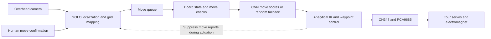

# ChessRobot

A 4-DOF Chinese chess robot with camera-based perception and electromagnetic pick-and-place.

[简体中文](README.md) · **English** · [日本語](README_JA.md)

**Explore the implementation:** [Vision and algorithms](docs/technical-notes.en.md#vision-history) · [Mathematical models](docs/technical-notes.en.md#mathematical-models) · [Hardware gallery](docs/technical-notes.en.md#hardware-gallery) · [Setup and operation](docs/setup.en.md)

ChessRobot, also called “智弈·灵手”, is a team-built undergraduate robotics project. An overhead camera detects human moves, a software board selects a response, and a four-joint arm transfers magnetic pieces. The project explores how perception, game state, and physical actuation can work together on a small desktop board.

The course prototype uses **human-confirmed moves**. Its vision development progressed from circle detection and character classification to YOLO localization and temporal stabilization. A fourth-generation pipeline combining automatic board rectification and grid classification is under development for arbitrary-position recognition.


[Watch the full physical demonstration](https://www.bilibili.com/video/BV1aXLn6HEQd). This video documents the course prototype; it does not establish fourth-generation integration or general recognition accuracy.

## System architecture



Processing runs on a Windows PC. A CH347 USB bridge connects the PC to the PCA9685 servo driver and relay control. A USB camera observes a 35 × 35 cm beige flexible board with 32 handmade magnetic pieces, approximately 30 mm in diameter. The hardware geometry, calibration, and compensation values are specific to this prototype.

## Engineering highlights

**Vision and data.** The main pipeline maps detected piece centers into a 10 × 9 board through a four-point homography. ROI masking, local contrast enhancement, centroid smoothing, and track-history voting reduce interference from the background and unstable detections. A standard opening supplies piece identities; the current detector does not independently classify every piece character. After moving, the human presses Space to submit a board snapshot.

**Motion control.** A geometric inverse-kinematics solver converts target coordinates into four joint commands. Empirical lateral, radial, and height compensation address placement offsets. Staged vertical pickup, an 8 mm near-board approach, and transfer at a clearance height reduce contact with neighboring pieces. Cartesian interpolation issues commands at a nominal 50 Hz; timing depends on the host and hardware. Joint position and final placement are not measured by a servo feedback loop in this implementation.

**Game state and coordination.** The rule module stores positions, checks piece movement constraints, and enumerates candidate moves. A PyTorch CNN scores 8,100 source–destination pairs, with selection restricted to candidates returned by the rule module. If `game/aaa.pth` is unavailable, the engine selects a random candidate. The orchestrator coordinates vision and motion through a queue and suppresses visual move reports while the arm moves. The current rule implementation is not a tournament-complete adjudicator.

## Four generations of vision

| Generation | Approach and work | Main finding and status |
| :--- | :--- | :--- |
| **1 — Circles and characters** | Hough-circle localization, color analysis, and a grayscale ResNet-18 character classifier trained with synthetic character images. | Historical prototype. Lighting, small character crops, and the synthetic-to-real gap limited physical-board recognition. |
| **2 — Multi-class YOLO** | Physical image acquisition, manual annotation, and YOLO fine-tuning for 14 piece classes. Team records describe 500 images of the original green mat and 120 after changing to beige. | Historical experiments. The board change introduced domain shift; similar characters remained difficult to distinguish. |
| **3 — Localization and state tracking** | Single-class localization, homography mapping, track stabilization, and human-confirmed board differences. | Current robot entry point. Supported the course demonstration, with standard-opening initialization and manual confirmation. |
| **4 — Rectified grid classification** | Four-corner pose estimation, perspective normalization, synthetic board data, and Swin-based classification of 90 intersections into 16 states. | In development. Project-specific training, evaluation, and robot integration remain milestones; no project-specific accuracy is reported here. |

The main design change is from recognizing isolated characters to estimating a structured board. Generation 3 prioritized a demonstrable physical system; Generation 4 aims to recover piece identity directly and support mid-game and endgame layouts. [Technical notes](docs/technical-notes.en.md) distinguish current code, historical experiments, and the new development path.

## Team contributions

| Member | Main responsibility | Contribution |
| :--- | :--- | :--- |
| **Tian Junshuo / 田峻硕** | Team lead, mechanics and motion | Arm assembly, hardware drivers, inverse kinematics, and pickup/transfer motion. |
| **Chaoran Liu / 刘超然** | Vision perception | Independently collected and annotated the physical vision data; led vision experiments and iteration, prepared the board and magnetic pieces, developed the GUI prototype, and assisted motion-compensation parameter tuning. Leads the fourth-generation vision work. |
| **Zichen Zhang / 张子琛** | Game rules and decision | Board representation, movement rules, and the PyTorch move-selection module. |
| **Yilong Xing / 邢义龙** | System integration and fixtures | Electrical wiring, power distribution, end-effector fixtures, and assistance with hardware integration. |

Reports, slides, and oral presentations were shared by all four members. Module ownership distinguishes individual work from the complete team's system.

## Validation and current scope

| Evidence | Observation | Scope |
| :--- | :--- | :--- |
| Team-recorded placement trial | **18 of 20 consecutive robot moves covered the target intersection center**; two were offset. | A 90% center-coverage rate in this small trial. It is not a measured millimeter error, a recognition score, or a full-match success rate. |
| Physical video | Magnetic pickup, transfer, placement, and return motions. | Demonstration of the course prototype, not a controlled recognition benchmark. |
| Vision data collection | Team-reported 620 annotated physical images across two board backgrounds. | Describes dataset preparation, not model accuracy; raw training data are not fully included in this repository. |
| Fourth-generation recognition | Development approach documented. | No independently measured result for this robot is published here. |

The present system requires four-corner calibration, manual orientation selection when automatic detection fails, and move confirmation. Captures can create track-ID ambiguity. Automatic color/orientation detection has a known implementation issue, and the GUI needs additional integration work. These constraints and the distinction between the demonstration and the checked-in configuration are described in the [technical notes](docs/technical-notes.en.md).

## Quick start

The robot entry point targets Windows 10/11, 64-bit Python 3.10+, a CUDA-capable PyTorch environment, and the connected physical hardware. `requirements.txt` provides dependency lower bounds rather than a tested environment lockfile.

```powershell
git clone https://github.com/TJS-Git-Hub/ChessRobot.git
cd ChessRobot
python -m pip install -r requirements.txt
```

Prepare the WCH driver and `CH347DLLA64.DLL`, check the device and calibration settings, and provide the matching `recognition/models/best.pt` detector. The optional decision checkpoint is `game/aaa.pth`. Model names alone do not establish a checkpoint's classes or training history.

```powershell
python main.py
```

Starting the controller moves the arm toward standby. Complete hardware setup and clearance checks first. For calibration, keyboard controls, GUI status, missing assets, and troubleshooting, use the [setup guide](docs/setup.en.md).

## Further development and documentation

- **Vision:** prepare project-specific piece crops and empty-board images, train and evaluate the rectified grid classifier, then integrate state changes with the robot. Include captures, partial occlusion, displaced pieces, and endgames in evaluation.
- **Motion:** align reach calculations with the active calibration, repeat placement trials across the board, and investigate smoother acceleration profiles.
- **Decision and integration:** validate movement constraints and checkpoint behavior, complete GUI interfaces, and evaluate future decision improvements against a defined baseline.

[Technical notes](docs/technical-notes.en.md) cover algorithms, code references, results, and development status. The [setup guide](docs/setup.en.md) covers dependencies and operation. Each document links to its Chinese and Japanese versions.

Code in this repository is provided under the [MIT License](LICENSE). The project uses Ultralytics YOLO, OpenCV, PyTorch, PyQt5, and WCH hardware interfaces. The fourth-generation study also draws on OpenMMLab and a referenced Chinese-chess recognition implementation, identified in the technical notes. Third-party components retain their respective licenses.
