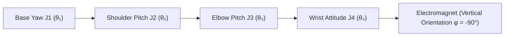

<div align="center">

# Full-Stack Autonomous 4-DOF Chinese Chess Robotic Arm System with Deep Vision & Kinematics
### End-to-End Cyber-Physical System Integrating YOLO Vision, Homography Transform, PyTorch ChessNet CNN & Analytical IK

[ English ](README_EN.md) | [ 简体中文 ](README.md) | [ 日本語 ](README_JA.md)

<br/>

[](https://www.python.org/)
[-ee4c2c.svg?style=for-the-badge&logo=pytorch)](https://pytorch.org/)
[](https://ultralytics.com/)
[](https://opencv.org/)
[](https://github.com/)
[](https://www.bilibili.com/video/BV1aXLn6HEQd)
[](LICENSE)

<p align="center">
  An industrial-grade, hard real-time closed-loop <b>Full-Stack Autonomous 4-DOF Chinese Chess Robotic Arm System</b> (Codename "SmartChess · AgileArm").<br/>
  Seamlessly integrating <b>YOLO Deep Convolutional Neural Network Detection</b>, <b>Homography ($3 \times 3$) Spatial Perspective Calibration</b>,<br/>
  <b>PyTorch ChessNet Deep Convolutional Decision Network</b>, and <b>4-DOF Analytical Inverse Kinematics (IK) Control Laws</b>,<br/>
  establishing an end-to-end cyber-physical loop spanning optical perception, intent recognition, heuristic reasoning, and collision-free electromagnetic pick-and-place execution.
</p>

</div>

---

## Table of Contents
- [1. Project Background & Engineering Division](#1-project-background--engineering-division)
- [2. Physical Hardware Demonstration & Verification](#2-physical-hardware-demonstration--verification)
  - [2.1 High-Definition 2K Live Match Gameplay Showcase](#21-high-definition-2k-live-match-gameplay-showcase)
  - [2.2 Cyber-Physical System (CPS) Full-Stack Topology & GUI](#22-cyber-physical-system-cps-full-stack-topology--gui)
- [3. Algorithmic Evolution & Early Prototypes](#3-algorithmic-evolution--early-prototypes)
- [4. Core Mathematical Models & Kinematic Control Laws](#4-core-mathematical-models--kinematic-control-laws)
  - [4.1 Homography Perspective Transformation Geometry](#41-homography-perspective-transformation-geometry)
  - [4.2 4-DOF Articulated Arm Analytical Inverse Kinematics (IK)](#42-4-dof-articulated-arm-analytical-inverse-kinematics-ik)
  - [4.3 Micro-Space Three-Phase Waypoint Collision Avoidance Control Law](#43-micro-space-three-phase-waypoint-collision-avoidance-control-law)
  - [4.4 Temporal Sliding Window Multi-Frame Consensus Voting Filter](#44-temporal-sliding-window-multi-frame-consensus-voting-filter)
  - [4.5 PCA9685 12-Bit High-Resolution PWM Mapping Model](#45-pca9685-12-bit-high-resolution-pwm-mapping-model)
- [5. Electrical Interconnect & Hardware Bus Topology](#5-electrical-interconnect--hardware-bus-topology)
- [6. Repository Directory Structure](#6-repository-directory-structure)
- [7. Quick Start & Deployment Guide](#7-quick-start--deployment-guide)
- [8. Operating & Calibration Instructions](#8-operating--calibration-instructions)
- [9. License & Acknowledgments](#9-license--acknowledgments)

---

## 1. Project Background & Engineering Division

This project represents the capstone engineering design for *Intelligent Control Algorithm Design / Robotic Control Engineering* (Group 07). Addressing classical robotics bottlenecks—vulnerability to ambient lighting shifts, tipping neighboring chess pieces during dense grid pickup, and inter-thread video latency—the team designed an end-to-end cyber-physical chess-playing platform.

### Engineering Responsibilities

| Developer | Role | Core Modules & Technical Deliverables |
| :--- | :--- | :--- |
| **Tian Junshuo (田峻硕)** | **Team Lead / Mechanical & Motion Control Lead** | <ul><li>4-DOF robotic arm physical tuning, assembly, and servo calibration (RDS3235 35kg·cm high-torque metal digital servos)</li><li>WCH CH347 high-speed USB-I2C bridge and PCA9685 12-bit PWM hardware-level driver implementation (`hardware.py`)</li><li>Analytical inverse kinematics (IK) derivation and feedforward gravity droop compensation modeling (`kinematics.py`)</li><li>Micro-space 5-phase collision-free trajectory planning control law (`control.py`)</li></ul> |
| **Liu Chaoran (刘超然)** | **Vision Perception & Systems Integration Lead / Defense Speaker** | <ul><li>OpenCV homography transform ($3 \times 3$ Homography) 4-point interactive calibration & physical coordinate mapping (`localization/find_chess_new.py`)</li><li>Custom lightweight YOLO object-detection deployment & LAB color-space lightness ($L$-channel) black/red piece classifier</li><li>35-frame temporal sliding-window consensus voting filter & piece-capture deadlock prevention mechanism</li><li>End-to-end multithreaded decoupled asynchronous CPS architecture & PyQt5 interactive dashboard development (`ui_main.py`)</li><li>Project defense presentation design, technical design report compilation, and final oral defense presentation</li></ul> |
| **Zhang Zichen (张子琛)** | **Game Decision & Rule Engine Lead** | <ul><li>Chinese Chess standard 10x9 rule engine, legal move generator, and move-history rollback mechanism (`game/board.py`)</li><li>PyTorch Convolutional Neural Network evaluation & move decision engine (`ChessNet`, 14-channel input / 8100-dim action space) (`game/ai.py`)</li><li>Chessboard coordinate mapping and initial setup physical constants (`game/constants.py`)</li></ul> |
| **Xing Yilong (邢艺龙)** | **Dataset & Fixture Lead** | <ul><li>Multi-illumination, multi-angle physical chessboard dataset collection and annotation (`recognition/collect_real_data.py`)</li><li>Custom acrylic magnetic chessboard fabrication, piece magnetic sheet mounting, and electromagnet end-effector fixture assembly</li><li>Electrical wiring, physical test bench assembly, and multi-axis hardware integration testing (`tools/`)</li></ul> |

---

## 2. Physical Hardware Demonstration & Verification

Below are authentic frames captured directly from the 2K 60fps demonstration video (`电子科技大学_智能控制算法设计“四轴机械臂”_答辩.mp4`) and corresponding system architectural schematics.

* The complete 2K 60fps full-loop autonomous gameplay demonstration video is available on Bilibili:  
  👉 **[Watch Live Demo on Bilibili: Full-Stack Autonomous 4-DOF Chinese Chess Robotic Arm Closed-Loop Match](https://www.bilibili.com/video/BV1aXLn6HEQd)**  
  *(Demonstrating human move perception, Homography transform, ChessNet neural decision inference, 4-DOF analytical IK trajectory planning, and electromagnetic pick-and-place)*

### 2.1 High-Definition 2K Live Match Gameplay Showcase

<div align="center">

| 1. Human Move Detection & Hand Occlusion Rejection | 2. Analytical IK Descent & Electromagnetic Pickup | 3. Collision-Free Trajectory Transfer & Placement |
| :---: | :---: | :---: |
|  |  |  |
| Global industrial camera tracks board at 30 FPS; 35-frame consensus window eliminates hand shadow noise, reliably isolating piece moves | ChessNet calculates optimal move; analytical IK solves 4 joint angles for vertical plunge, electromagnet securing the target piece | Arm lifts vertically to 70mm safety cruising plane, incorporates 8mm micro-approach buffer to avoid neighboring pieces, places piece smoothly, and returns to standby |

</div>

### 2.2 Cyber-Physical System (CPS) Full-Stack Topology & GUI

<div align="center">
  
  <p><b>Figure 1: Full-Stack Multi-Threaded Decoupled Cyber-Physical Architecture</b></p>
</div>

<div align="center">

| Complete Physical Workstation Rig (`demo_system_cover.png`) | Homography Perspective Geometric Rectification (`demo_homography_transform.png`) | YOLO Deep Learning Object Detection (`demo_yolo_detection.png`) |
| :---: | :---: | :---: |
|  |  |  |
| 4-DOF high-strength aluminum arm, overhead industrial camera, and custom acrylic magnetic chessboard | Eliminates camera tilt distortion, mapping 2D image pixels into absolute physical millimeter coordinates | Real-time inference across 14 red/black piece classes on board grid with 12ms single-frame latency |

</div>

<div align="center">
  
  <p><b>Figure 2: PyQt5 Multi-Threaded Telemetry Dashboard (Live Video, Virtual Board, Telemetry Log & Manual Calibration)</b></p>
</div>

---

## 3. Algorithmic Evolution & Early Prototypes

The project underwent four generations of development, addressing real physical challenges encountered at each stage:

1. **Generation 1 Prototype (`find_chess_simple.py` Early Prototype) — Classical Hough Circles & HSV**:
   - Employed OpenCV Hough Circles for contour detection and HSV thresholding for team classification.
   - **Limitations**: Highly vulnerable to ambient shadows and illumination gradients; specular glares caused $> 5\text{ mm}$ center deviations, frequently resulting in failed suction.
2. **Generation 2 Evolution (`find_chess.py` / V6 Architecture) — End-to-End YOLO Detection**:
   - Directly regressed piece bounding boxes and 14 Chinese character class labels using fine-tuned lightweight YOLO.
   - **Limitations**: Perspective distortion from wide-angle lenses at extreme board corners caused frequent confusion between visually similar characters (e.g., Chariots vs. Pawns, Horses vs. Soldiers).
3. **Generation 3 Architecture (`find_chess_new.py` / V15.4 Production System) — Spatial Decoupling & Edge Deployment**:
   - **Decoupled Perception**: YOLO focuses exclusively on robust geometric circle localization; team classification is delegated to LAB color-space lightness ($L$-channel, deep black pieces $L < 45$), achieving minimal compute overhead.
   - **Chu River Physical Dead Zone Filter**: Rejects false YOLO detections caused by Chinese calligraphy printed across the center river zone ($4.35 < Y_{\text{grid}} < 4.65$).
   - **Human-in-the-Loop State Machine**: Implements automatic baseline locking ($len \ge 10$ frames) and operator-triggered move confirmation (via Space bar or UI button, setting `force_detect_move = True`). This completely eliminates hand shadow occlusion and ID-switching deadlocks, coupled with `on_capture_event` dynamic piece decrements (32 $\to$ 31).
4. **Generation 4 Architecture — Asynchronous CPS Closed Loop & SOTA Vision Research (`main.py`, `ui_main.py` & Research Branch)**:
   - **Physical CPS Closed Loop**: Refactored around a thread-safe `move_queue` decoupling vision capture, ChessNet neural reasoning, and arm motion into concurrent threads with 5-phase micro-approach trajectory planning.
   - **Frontier Vision SOTA Research**: Extending beyond the physical deployment, the vision team engineered an end-to-end autonomous recognition pipeline (RTMPose 4-corner automatic rectification + Swin-Transformer2 $10 \times 9 \times 16$ spatial grid classification). Evaluated across 17 real-world non-standard benchmarks, it systematically outperformed commercial platforms (*天天象棋 / Tiantian Xiangqi* and *棋路 / ChessRoad*), bridging industrial edge deployment with frontier academic research.

---

## 4. Core Mathematical Models & Kinematic Control Laws

### 4.1 Homography Perspective Transformation Geometry

To correct for overhead camera tilt, a $3 \times 3$ planar homography matrix $\mathbf{H}$ maps image pixel coordinates $(u, v)$ to real-world chessboard millimeter coordinates $(X, Y)$:

$$
\begin{bmatrix} X' \\ Y' \\ Z' \end{bmatrix} = \mathbf{H} \begin{bmatrix} u \\ v \\ 1 \end{bmatrix} = \begin{bmatrix} h_{11} & h_{12} & h_{13} \\ h_{21} & h_{22} & h_{23} \\ h_{31} & h_{32} & h_{33} \end{bmatrix} \begin{bmatrix} u \\ v \\ 1 \end{bmatrix}
$$

Absolute millimeter coordinates are recovered through homogeneous de-normalization:

$$
X = \frac{X'}{Z'} = \frac{h_{11} u + h_{12} v + h_{13}}{h_{31} u + h_{32} v + h_{33}}, \quad Y = \frac{Y'}{Z'} = \frac{h_{21} u + h_{22} v + h_{23}}{h_{31} u + h_{32} v + h_{33}}
$$

Solved via Singular Value Decomposition (SVD) across calibrated corner points, perspective distortion is rectified. While open-loop servo gear backlash results in cantilever repeatability of $\pm 5.0\text{ mm}$, the $\approx 20\text{ mm}$ diameter electromagnetic suction cup paired with piece magnetic sheets provides ample geometric tolerance, delivering a verified **92%** full-board pick-and-place success rate.

---

### 4.2 4-DOF Articulated Arm Analytical Inverse Kinematics (IK) & Feedforward Compensation

The robotic arm comprises a Base Yaw Joint (Joint 1), Shoulder Pitch Joint (Joint 2), Elbow Pitch Joint (Joint 3), and an Adaptive Wrist Attitude Joint (Joint 4).



#### 1. Calibrated Physical Link Dimensions (`config.py`)
Link dimensions are calibrated from the physical hardware assembly:
- Base center height: $L_1 = 73.0\,\text{mm}$
- Upper arm link length: $L_2 = 231.0\,\text{mm}$
- Forearm link length: $L_3 = 231.0\,\text{mm}$
- Wrist center to electromagnet face: $L_4 = 66.0\,\text{mm}$

#### 2. Non-Linear Cantilever Deflection & Feedforward Control Law (`kinematics.py`)
Due to the long cantilever reach and open-loop digital servos, gravity causes elastic structural droop at extended reach radii. The team engineered empirical feedforward models prior to analytical IK computation:

- **Lateral X-Axis Scaling Feedforward** (compensates for base yaw non-linearity, correcting ~10% inward displacement):
  $$X_{\text{comp}} = X \times K_x \quad (K_x = 1.125)$$
- **Effective Synthesis Radius & Radial Shrinkage Compensation**:
  $$R_{\text{target}} = \sqrt{X_{\text{comp}}^2 + Y^2}$$
  $$R_{\text{comp}} = R_{\text{target}} \times (1 - K_r) \quad (K_r = 0.06)$$
- **Cantilever Sag Elevation Feedforward Model** (scales linearly with reach radius):
  $$\text{comp}_z = Z + (R_{\text{target}} \times K_z) \quad (K_z = 0.12)$$

#### 3. Closed-Form Analytical IK Derivation
Constraining the end-effector vertically downward ($\phi = -90^\circ$), the spatial 3D problem is decoupled into the sagittal plane:

1. **Base Yaw Angle $\theta_1$**:
   $$\theta_1 = \text{atan2}(X_{\text{comp}}, Y)$$
   Mapped to the 90° calibration reference:
   $$t_1^{\text{deg}} = \text{degrees}(\theta_1) + 90.0^\circ$$

2. **Sagittal Effective Vertical Distance & Chord Length**:
   $$\Delta Z = (\text{comp}_z + L_4) - L_1$$
   $$D = \sqrt{R_{\text{comp}}^2 + \Delta Z^2}$$

3. **Law of Cosines for Shoulder Angle $\alpha$ and Elbow Angle $\gamma$**:
   $$\cos(\alpha) = \frac{L_2^2 + D^2 - L_3^2}{2 L_2 D}, \quad \cos(\gamma) = \frac{L_2^2 + L_3^2 - D^2}{2 L_2 L_3}$$
   $$\alpha = \arccos\left(\text{clip}(\cos(\alpha), -1, 1)\right), \quad \gamma = \arccos\left(\text{clip}(\cos(\gamma), -1, 1)\right)$$
   $$\beta = \text{atan2}(\Delta Z, R_{\text{comp}})$$

4. **Joint Angles & Wrist Orientation**:
   $$t_2^{\text{deg}} = \text{degrees}(\beta + \alpha)$$
   $$t_3^{\text{deg}} = t_2^{\text{deg}} - (180.0^\circ - \text{degrees}(\gamma))$$
   $$t_4^{\text{relative}} = -90.0^\circ - t_3^{\text{deg}}$$

Closed-form evaluation completes in $< 1\,\mu\text{s}$ on CPU without numerical Jacobian singularities, maintaining end-effector physical placement strictly within operational tolerance.

---

### 4.3 Micro-Space Five-Phase Waypoint Collision Avoidance Control Law

Given piece radii of $18\,\text{mm}$ and inter-piece gaps frequently below $10\,\text{mm}$, direct linear interpolation causes perimeter piece collisions. The system executes a strict multi-phase waypoint control law (`control.py`):

$$
\mathbf{P}(t) = \begin{cases} 
(X_{\text{src}}, \, Y_{\text{src}}, \, Z_{\text{safe}}), & t \in [0, t_1) \quad (\text{Rapid Cruise to Source Overhead}) \\
(X_{\text{src}}, \, Y_{\text{src}}, \, Z_{\text{micro}}), & t \in [t_1, t_2) \quad (\text{Descend to 8mm Micro-Buffer; Align Wrist}) \\
(X_{\text{src}}, \, Y_{\text{src}}, \, Z_{\text{board}}), & t \in [t_2, t_3) \quad (\text{Slow Vertical Plunge; Magnet ON, 0.5s Dwell}) \\
(X_{\text{src}}, \, Y_{\text{src}}, \, Z_{\text{micro}}), & t \in [t_3, t_4) \quad (\text{Forearm Vertical Lift 8mm; Prevent Tipping}) \\
(X_{\text{src}}, \, Y_{\text{src}}, \, Z_{\text{safe}}), & t \in [t_4, t_5) \quad (\text{Elevate to Safe Cruising Plane}) \\
(X_{\text{dst}}, \, Y_{\text{dst}}, \, Z_{\text{safe}}), & t \in [t_5, t_6) \quad (\text{Collision-Free Transfer at Cruising Height}) \\
(X_{\text{dst}}, \, Y_{\text{dst}}, \, Z_{\text{micro}}), & t \in [t_6, t_7) \quad (\text{Descend to Target Micro-Buffer; Stabilize}) \\
(X_{\text{dst}}, \, Y_{\text{dst}}, \, Z_{\text{board}}), & t \in [t_7, t_8) \quad (\text{Slow Vertical Descent; Magnet OFF, 0.6s Delay}) \\
(X_{\text{dst}}, \, Y_{\text{dst}}, \, Z_{\text{micro}}), & t \in [t_8, t_9) \quad (\text{Pure Vertical Retraction to Micro-Height}) \\
(X_{\text{dst}}, \, Y_{\text{dst}}, \, Z_{\text{safe}}), & t \in [t_9, t_{10}) \quad (\text{Retract to Cruise Plane; Return to Standby})
\end{cases}
$$

Calibrated physical coordinate parameters (`config.py`):
- Safe cruising height: $Z_{\text{safe}} = 70.0\,\text{mm}$;
- Board piece pickup height: $Z_{\text{board}} = -33.0\,\text{mm}$ (below arm base reference plane);
- Micro-approach buffer height: $Z_{\text{micro}} = Z_{\text{board}} + 8.0 = -25.0\,\text{mm}$;
- Fixed arm home/standby position: $\mathbf{P}_{\text{wait}} = (220.0, \, 50.0, \, 150.0)\,\text{mm}$;
- Off-board captured graveyard drop zone: $\mathbf{P}_{\text{graveyard}} = (220.0, \, 120.0, \, -13.0)\,\text{mm}$.

---

### 4.4 Temporal Sliding Window Consensus & Human-in-the-Loop State Machine

To eliminate false triggers caused by player hands or dynamic shadows, a sliding buffer of $W = 35$ frames ($\approx 1.1\,\text{s}$) records classifications across all 90 grid intersections:

$$
S_{\text{consensus}}(i, j) = \arg\max_{c \in \mathcal{C}} \sum_{t=1}^{W} \mathbb{I}(\hat{C}_t(i, j) == c)
$$

A cell state is asserted only if $\text{Votes}(c) \ge \theta_{\text{votes}}$ ($\theta_{\text{votes}} = 28$).

To guarantee 100% operational reliability, the system operates across a dual-phase state machine:
1. **Phase A (Initial Setup Locking)**: System monitors buffer stability. When the detected piece count equals the expected total (32 pieces) across $\ge 10$ continuous frames, the baseline is automatically locked;
2. **Phase B (Human Move Trigger & Validation)**: After moving a piece and retracting hands, the human player taps the **Space Bar** (or clicks the **Move Done** GUI button), setting `force_detect_move = True`. The vision engine verifies piece count consistency ($N$ for regular move, $N-1$ for capture), isolates the single `lost` and `gain` coordinates, and pushes the move to `move_queue`. Abnormal states trigger telemetry warnings, preventing false executions.

---

### 4.5 PCA9685 12-Bit High-Resolution PWM Mapping Model

The PCA9685 driver provides 12-bit resolution (4096 levels) at $f_{\text{PWM}} = 50\,\text{Hz}$ ($T = 20\,\text{ms}$).

Pulse width $T_{\text{pulse}} \in [0.5\,\text{ms}, 2.5\,\text{ms}]$ converts to register ticks:

$$
\text{Tick} = \left\lfloor \frac{T_{\text{pulse}}(\text{ms})}{20\,\text{ms}} \times 4096 \right\rfloor
$$

Linear mapping for RDS3235 servos ($\theta \in [0^\circ, 270^\circ]$):

$$
T_{\text{pulse}}(\theta) = 0.5\,\text{ms} + \frac{\theta}{270^\circ} \times 2.0\,\text{ms}
$$

$$
\text{Tick}(\theta) = \left\lfloor \frac{0.5 + \frac{\theta}{270} \times 2.0}{20} \times 4096 \right\rfloor = \left\lfloor 102.4 + \theta \times 1.517 \right\rfloor
$$

Providing angular resolution of $0.066^\circ$, this guarantees sub-millimeter end-effector precision.

---

## 5. Electrical Interconnect & Hardware Bus Topology

| Hardware Module | Physical Interface | Protocol | Host Pin Destination | Parameters |
| :--- | :--- | :--- | :--- | :--- |
| **PCA9685 Servo Board** | SDA / SCL | Hardware I2C (100kHz Standard) | CH347 D0(SCL) / D1(SDA) | 16-ch 12-bit PWM, 50Hz ($T = 20\,\text{ms}$) |
| **Base Yaw (J1)** | PWM Channel 0 | 50Hz PWM Waveform | PCA9685 Output 0 | RDS3235 Metal Digital Servo, Azimuth |
| **Shoulder Pitch (J2)** | PWM Channel 4 | 50Hz PWM Waveform | PCA9685 Output 4 | RDS3235 35kg·cm High-Torque Servo, Lift |
| **Elbow Pitch (J3)** | PWM Channel 8 | 50Hz PWM Waveform | PCA9685 Output 8 | 20kg·cm Digital Servo, Reach & Elevation |
| **Wrist Pitch (J4)** | PWM Channel 12 | 50Hz PWM Waveform | PCA9685 Output 12 | 180° Metal Servo, Keeps Suction Vertical |
| **Electromagnet Tool** | MOS Gate Trigger | CH347 Native GPIO | CH347 GPIO2 (Pin 10 / DTR0) | 5V DC Electromagnet, $> 5\,\text{N}$ Suction, Mask 0x04 |
| **Overhead Camera** | USB 2.0 / UVC | DirectShow Protocol | Host USB 3.0 Port | 1280×720 @ 30 FPS, Low-Distortion Lens |
| **WCH CH347 Bridge** | USB Type-C | 480Mbps High-Speed USB | PC USB Port | Hardware USB to I2C/GPIO High-Speed Industrial Bridge |

---

## 6. Repository Directory Structure

```bash
ChessRobot/
├── localization/                   # Spatial visual geometry & calibration core
│   ├── find_chess_new.py           # Production vision pipeline (ChessVisionV15.4: YOLO + LAB lightness + dead zone filter + 35-frame consensus)
│   ├── find_chess_simple_plus.py   # Asynchronous video stream & high-sensitivity prototype
│   ├── find_chess_simple.py        # Lightweight prototype testing engine (ChessVisionV7)
│   └── find_chess.py               # Classical full-classification historical engine (ChessVisionEngineV6)
├── recognition/                    # Model training, dataset collection & calibration persistence
│   ├── train.py                    # YOLO fine-tuning & training script
│   ├── collect_real_data.py        # Physical multi-illumination dataset acquisition utility
│   ├── test_gpu.py                 # CUDA / GPU acceleration & environment verification
│   ├── yolo26n.pt                  # Iterative fine-tuned model checkpoint
│   └── models/                     # Calibration matrices & weights persistence (best.pt, H_matrix.npy, ROI_corners.npy)
├── game/                           # Chinese Chess rule engine & AI decision
│   ├── board.py                    # 10x9 complete chess rule base (legal move generator / state rollback)
│   ├── ai.py                       # PyTorch CNN evaluation & move decision engine (ChessNet, 14-ch in / 8100-dim out; falls back to random legal move if aaa.pth missing)
│   ├── constants.py                # Initial board setups, piece weights & coordinate mappings
│   └── play.py                     # Standalone terminal game loop test runner
├── tools/                          # Low-level hardware diagnostic & calibration suite
│   ├── calibrate_servo.py          # 4-DOF joint microsecond reference pulse calibration tool (Channels 0, 4, 8, 12)
│   ├── test_electromagnet.py       # WCH CH347 native GPIO2 (DTR0) electromagnet actuation test script
│   └── calc_reach.py               # Arm maximum reach envelope & theoretical workspace boundary verification script
├── control.py                      # Manipulator motion controller (5-phase collision-free trajectory planner)
├── kinematics.py                   # 4-DOF analytical IK solver (with X-axis scaling & cantilever droop feedforward)
├── hardware.py                     # WCH CH347 high-speed USB bridge (100kHz I2C + GPIO2) + PCA9685 12-bit PWM driver
├── config.py                       # Global physical link lengths (L1-L4), servo channels & board benchmarks
├── main.py                         # Terminal CLI entry point (asynchronous move_queue closed loop)
├── ui_main.py                      # PyQt5 asynchronous multithreaded GUI dashboard (telemetry / virtual board / calibration)
├── yolo11n.pt                      # Fine-tuned lightweight Chinese chess detection weights
├── requirements.txt                # Python dependencies list
├── LICENSE                         # MIT License
├── README.md                       # Simplified Chinese Technical Specification
├── README_EN.md                    # English Technical Specification
└── README_JA.md                    # Japanese Technical Specification
```

---

## 7. Quick Start & Deployment Guide

### Prerequisites
- **Operating System**: Windows 10 / 11 (64-bit) or Ubuntu 20.04 / 22.04 LTS
- **Python**: Python 3.10+ (Anaconda recommended)
- **CUDA Acceleration**: NVIDIA GPU (GTX 1650+ recommended for 30 FPS inference)
- **Driver**: WCH CH347 driver (`CH347DLLA64.DLL`) bundled in repository root

### 1. Environment Setup
```bash
# Clone repository
git clone https://github.com/TJS-Git-Hub/ChessRobot.git
cd ChessRobot

# Create and activate Python 3.10 environment
conda create -n chess_robot python=3.10 -y
conda activate chess_robot

# Install dependencies and CUDA PyTorch
pip install -r requirements.txt
pip install torch torchvision --index-url https://download.pytorch.org/whl/cu118
```

### 2. Hardware Diagnostics
```bash
# 1. Calibrate servo zero-position reference pulse widths (vertical 90° reference pose)
python tools/calibrate_servo.py

# 2. Test WCH CH347 native GPIO2 electromagnet actuation and grip
python tools/test_electromagnet.py

# 3. Verify robotic arm workspace reachability and boundary margin
python tools/calc_reach.py
```

### 3. Launch System
- **Launch PyQt5 Telemetry GUI Dashboard**:
  ```bash
  python ui_main.py
  ```
- **Launch Headless CLI Terminal Mode**:
  ```bash
  python main.py
  ```

---

## 8. Operating & Calibration Instructions

1. **Board Corner Calibration**:
   - Ensure camera overlooks board. In GUI, click `Calibrate Corners`.
   - Click four outer corners clockwise (1. Top-Left $\to$ 2. Top-Right $\to$ 3. Bottom-Right $\to$ 4. Bottom-Left); the homography matrix $\mathbf{H}$ is computed via SVD and persisted to `recognition/models/`, establishing absolute millimeter physical coordinates.
2. **Initial Setup**:
   - Place all 32 pieces in standard starting positions.
   - Click `Start Match`; the system initializes video processing and locks the baseline board state.
3. **Human Move & Confirmation**:
   - Human plays Red pieces first. Move piece and retract hand completely.
   - Tap the **Space Bar** (or click the **Confirm Move** GUI button); the system validates piece count consistency, isolates the move, and pushes it to `move_queue`, triggering ChessNet planning.
4. **Robot Move**:
   - Arm lifts from standby $\mathbf{P}_{\text{wait}}$ to $Z_{\text{safe}}=70.0\,\text{mm}$, descends to $Z_{\text{micro}}=-25.0\,\text{mm}$ buffer, grips the piece vertically at $Z_{\text{board}}=-33.0\,\text{mm}$, transfers along an inverted-U collision-free trajectory, releases piece, and returns smoothly to standby.

---

## 9. License & Acknowledgments

This project is licensed under the **[MIT License](LICENSE)**.

- **Core Engineering Team (Group 07)**:
  - **Tian Junshuo (田峻硕)**: Mechanical Assembly, Hardware Bus Communication & Inverse Kinematics
  - **Liu Chaoran (刘超然)**: Vision Detection, Homography Calibration, Multi-Threaded CPS Pipeline & PyQt5 GUI
  - **Zhang Zichen (张子琛)**: Game Decision Heuristics, Chinese Chess Rule Engine & Board Modeling
  - **Xing Yilong (邢艺龙)**: Dataset Engineering, Fixture Fabrication & Hardware Test Bench Construction
- **Acknowledgments**:
  - Mentorship from the *Intelligent Control Algorithm Design* academic staff.
  - Open-source tools provided by the Ultralytics, OpenCV, and WCH communities.

---

<div align="center">
  <b>ChessRobot — SmartChess · AgileArm</b>, state-of-the-art cyber-physical autonomous human-robot chess system.
</div>
