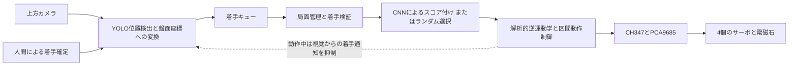

# ChessRobot

カメラによる盤面認識と電磁石による駒の搬送を組み合わせた、4自由度の中国象棋ロボット。

[简体中文](README.md) · [English](README_EN.md) · **日本語**

**詳細を読む：** [視覚認識](docs/technical-notes.ja.md#vision-history) · [運動制御](docs/technical-notes.ja.md#motion-hardware) · [着手選択](docs/technical-notes.ja.md#game-decision) · [数学モデル](docs/technical-notes.ja.md#mathematical-models) · [実機ギャラリー](docs/technical-notes.ja.md#hardware-gallery) · [セットアップ](docs/setup.ja.md)

ChessRobot（「智弈·灵手」）は、4名のチームで開発した学部のロボティクス授業プロジェクトです。上方カメラで人間の着手を検出し、ソフトウェア上の盤面から応手を選択して、4関節アームが磁性体の駒を搬送します。卓上環境で、視覚認識、局面管理、実機動作を連携させることに取り組みました。

授業用の試作機は**人間による着手確定**を用います。視覚処理は、円検出と文字分類から、YOLOによる位置検出と時系列安定化へ発展しました。任意局面の認識を目指し、盤面の自動補正と交点ごとの分類を組み合わせる第4世代を開発中です。


[実機デモ動画を見る](https://www.bilibili.com/video/BV1aXLn6HEQd)：授業用試作機での吸着・搬送・配置の記録です。

## システム構成



画像処理と全体の制御はWindows PC上で実行します。CH347 USBブリッジを介してPCA9685サーボドライバとリレーを制御します。USBカメラで35 × 35 cmのベージュ色の軟質盤を撮影し、直径約30 mmの手作り磁性駒32個を使用します。機構寸法、校正値、補償係数は、この試作機に合わせた値です。

## 3つのモジュールと設計

### 視覚認識：文字の認識から構造化された盤面へ

視覚モジュールは、カメラ画像を盤面上の変化に変換します。現行の実機は単一クラスのYOLOで駒を検出し、4点のホモグラフィで中心を10 × 9の交点へ対応付けます。ROI、CLAHE、中心座標の平滑化、追跡エネルギー、履歴の多数決により、背景の干渉や検出の揺らぎに対処します。駒の種類は標準初期配置と着手履歴から保持し、人間がSpaceキーで盤面を確定します。

以下の4世代は、課題に応じた開発の変遷です。現行の実機は第3世代を使用し、第4世代を次の開発段階としています。

| 世代 | 方法と取り組み | 得られた知見と状態 |
| :--- | :--- | :--- |
| **第1世代：円検出と文字分類** | Hough円検出、色解析、合成文字画像で学習したグレースケールResNet-18。 | 過去の試作。照明、小さな文字画像、合成画像と実画像の差が認識を制限。 |
| **第2世代：多クラスYOLO** | 実画像の収集、手動アノテーション、14種類の駒に対する微調整。チーム記録では旧緑色盤500枚と、ベージュ色盤への変更後120枚。 | 過去の実験。盤の変更によるドメインシフトと類似文字の混同が課題。 |
| **第3世代：位置検出と状態追跡** | 単一クラスの位置検出、ホモグラフィ、追跡の安定化、人間の確定操作後の盤面差分。 | 現在の実機エントリーポイント。授業のデモに使用し、標準初期配置と手動確定に依存。 |
| **第4世代：補正後の盤面分類** | 4隅の姿勢推定、透視変換、合成盤面データ、Swinによる90交点の16状態分類。 | 開発中。専用データでの学習、評価、実機統合は今後の工程。このロボットでの精度値は掲載していません。 |

[視覚アルゴリズム・データ・学習記録](docs/technical-notes.ja.md#vision-history) · [第3世代の処理一覧](docs/technical-notes.ja.md#vision-generation-3)

### 運動制御：盤面の交点から電磁吸着まで

運動モジュールは、着手の始点と終点をアーム座標へ変換し、4関節と電磁石を連携させて駒の移動と駒取りを実行します。

- **座標変換と逆運動学：** 格子間隔、河界幅、盤面オフセットからmm単位の目標を生成します。幾何学的な解析逆運動学で肩・肘角を求め、先端を下向きに保ちます。
- **配置の補償：** 逆運動学の前段に横方向の倍率、半径方向の補正、伸展距離に応じた高さ補正を加え、実機の配置ずれに合わせて調整します。
- **吸着と搬送：** 水平移動は安全高さで行います。盤面上8 mmで一度停止してからゆっくり垂直接近し、駒取りでは相手の駒を除去してから自分の駒を移します。
- **補間と駆動：** 直交座標の経由点を公称50 Hzで補間します。関節角をパルスへ変換し、CH347とPCA9685でサーボを駆動し、GPIO制御のリレーで電磁石を切り替えます。

現行実装は所定の動作列と経験的補償を用い、関節位置や実配置の測定フィードバックはありません。[運動設計・校正値・数式](docs/technical-notes.ja.md#motion-hardware)

### 着手選択：ルールによる候補生成とニューラル評価

着手選択モジュールはソフトウェアの盤面を管理し、人間の着手に対するロボットの応手を選びます。

- **盤面とルール：** 10 × 9の盤面に双方の駒を保持します。馬脚・象眼の妨害、河界・九宮の制限、経路上の駒などを確認し、候補手を生成します。
- **局面と行動の符号化：** 紅黒各7種類の駒を14 × 10 × 9テンソルで表し、始点90個と終点90個を8,100次元の行動空間に対応付けます。
- **着手の選択：** PyTorch CNNが各行動にスコアを付け、ルールモジュールの候補から最大値を選びます。現行入口は`game/aaa.pth`を使用し、未配置時は候補からランダムに選択します。

過去の着手選択コードには、棋譜から「局面・着手」の組を作る教師あり学習処理もあります。技術ノートでは過去の学習処理と現行推論を区別し、ルールの対応範囲を説明します。[ネットワーク・学習処理・統合](docs/technical-notes.ja.md#game-decision)

## モジュール間の連携

1. **認識と確定：** 視覚スレッドは撮影を続けます。人間の確定操作後、盤面差分から始点・終点を求め、着手キューへ渡します。
2. **局面更新と選択：** メインスレッドが座標を変換し、人間の着手を検証・反映してから、ルールと着手選択ネットワークで応手を選びます。
3. **実機実行：** ロボットの着手を検査し、視覚通知を抑止して移動・駒取りを実行します。指令列の正常復帰後にのみソフトウェア盤面と駒数を更新し、失敗時は停止して実物の確認を求めます。
4. **次の手番：** 動作列が戻った後、期待駒数と視覚の基準盤面を更新し、人間の次の着手を待ちます。

この連携はソフトウェア状態と指令順序に基づきます。実物の盤面との一致は実機での検証が必要です。[統合処理と検証範囲](docs/technical-notes.ja.md#system-coordination)

## チームの担当

| メンバー | 主担当 | 貢献内容 |
| :--- | :--- | :--- |
| **田峻硕 / Tian Junshuo** | リーダー、機構と運動制御 | アーム組立、ハードウェアドライバ、逆運動学、駒の把持と移送制御。 |
| **刘超然 / Chaoran Liu** | 視覚認識 | 実画像の収集とアノテーションを単独で担当。視覚処理の実験・改良、盤と磁性駒の製作、GUI試作、運動補償のパラメータ調整への協力、第4世代の開発。 |
| **张子琛 / Zichen Zhang** | ルールと着手選択 | 盤面表現、駒の移動規則、PyTorchによる着手選択モジュール。 |
| **邢艺龙 / Yilong Xing** | 統合と治具 | 配線、電源分配、電磁石の取付治具、ハードウェア統合の支援。 |

報告書、スライド、口頭発表は4名で分担しました。担当の記載により、個人の作業とチーム全体の成果を区別しています。

## 検証結果と現在の対応範囲

| 根拠 | 観察結果 | 適用範囲 |
| :--- | :--- | :--- |
| チーム記録の配置試験 | **連続20手中18回で、駒が目標交点の中心を覆いました。** 2回はずれがありました。 | この小規模試験の中心被覆率は90%。mm単位の位置誤差、認識精度、対局全体の成功率とは異なる指標です。 |
| 実機動画 | 電磁吸着、移送、配置、待機位置への復帰。 | 授業用試作機の記録。条件を統制した認識評価ではありません。 |
| 視覚データの準備 | チーム記録では2種類の盤で合計620枚の実画像をアノテーション。 | データ準備の記録であり、モデル精度を示すものではありません。全学習画像は同梱していません。 |
| 第4世代の認識 | 開発方法と目標を記載。 | このロボット上の独立した実測値は未掲載です。 |

授業用試作機は標準初期配置、4点校正、手動の向き指定、人間による着手確定を必要とします。駒取り時の追跡、GUI、到達範囲、動作結果の扱いは、[現行実装と再現上の制約](docs/technical-notes.ja.md#validation)にまとめています。

## クイックスタート

実機のエントリーポイントはWindows 10/11、64-bit Python 3.10以上、CUDA対応のPyTorch環境、接続済みの実機を前提とします。`requirements.txt`は依存関係の下限を示すもので、動作検証済みの環境を固定するファイルではありません。

```powershell
git clone https://github.com/TJS-Git-Hub/ChessRobot.git
cd ChessRobot
python -m pip install -r requirements.txt
```

WCHドライバと`CH347DLLA64.DLL`を用意し、接続先と校正値を確認します。検出器は処理に合う`recognition/models/best.pt`、任意の着手選択モデルは`game/aaa.pth`に配置します。

```powershell
python main.py
```

コントローラの初期化でアームが待機位置へ動きます。配線と動作範囲を確認してから実行してください。校正、キー操作、GUIの状態、外部ファイル、トラブル対応は[セットアップガイド](docs/setup.ja.md)を参照してください。

## 今後の開発とドキュメント

- **視覚：** 本機の駒画像と空盤画像を準備し、補正後の盤面分類器を学習・評価して、実機の状態更新に接続します。駒取り、部分遮蔽、交点からのずれ、終盤を評価に含めます。
- **運動：** 到達可能範囲の計算と実際の校正値を一致させ、盤面の各領域で配置試験を繰り返し、滑らかな加減速を検討します。
- **着手選択と統合：** 移動制約と重みの読込みを検証し、接続済みGUIを実機で検証します。今後の着手選択の改良は基準方式との比較で評価します。

[技術ノート](docs/technical-notes.ja.md)ではアルゴリズム、コード、評価、開発状況を扱い、[セットアップガイド](docs/setup.ja.md)では環境と操作を扱います。各文書には中・英・日の切替リンクがあります。

本リポジトリのコードは[MITライセンス](LICENSE)で公開しています。Ultralytics YOLO、OpenCV、PyTorch、PyQt5、WCHのハードウェアインターフェースを使用します。第4世代の検討ではOpenMMLabと既存の中国象棋認識実装も参考にしており、技術ノートに出典を記載しています。第三者のコンポーネントにはそれぞれのライセンスが適用されます。

## 保守とオフライン検証

2026-10 の保守修正：黒画素比率、GUI映像、タプル形式の盤面描画を修正し、自将への王手と将帥の対面を着手候補から除外しました。補間区間は送信前に逆運動学で検査し、ドライバ失敗を伝播します。指令列の正常復帰後にのみソフトウェア盤面を更新し、失敗時は停止して実物確認を求めます。ソフトウェア停止は電源遮断ではありません。オフライン回帰テスト7件が通過しましたが、カメラ、CH347、実機は接続しておらず、過去の配置成績は再測定していません。

2026-10-24：移動前に始点・終点の配置点、8 mm待避点、安全高さを検査します。駒取りでは盤外置場と自駒の始点も検査し、既知の到達不能点があれば最初の運動・吸着前に拒否します。各補間区間の検査は継続しますが、全動作の衝突保証ではありません。オフライン回帰9件が通過しました。校正値は変更せず、現行IKは引き続き11/90目標を拒否するため、実測が必要です。
