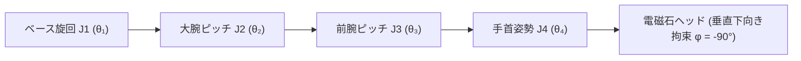

<div align="center">

# マシンビジョンと深層畳み込みニューラルネットワークに基づく4自由度中国将棋対局ロボットシステム
### YOLO物体検出・ホモグラフィ幾何補正・PyTorch ChessNet CNN・解析的逆運動学（IK）統合サイバーフィジカルシステム

[ English ](README_EN.md) | [ 简体中文 ](README.md) | [ 日本語 ](README_JA.md)

<br/>

[](https://www.python.org/)
[-ee4c2c.svg?style=for-the-badge&logo=pytorch)](https://pytorch.org/)
[](https://ultralytics.com/)
[](https://opencv.org/)
[](https://github.com/)
[](https://www.bilibili.com/video/BV1aXLn6HEQd)
[](LICENSE)

<p align="center">
  本プロジェクトは、完全自律・ハードリアルタイム閉ループ制御を実現した<b>産業用全スタック中国将棋（シャンチー）人機対局ロボットシステム</b>（コードネーム「智弈·霊手」）です。<br/>
  <b>YOLO 畳み込みニューラルネットワーク目標検出</b>、<b>ホモグラフィ（$3 \times 3$）透視投影幾何補正</b>、<br/>
  <b>PyTorch ChessNet 深層畳み込み対局決定ネットワーク</b>、および <b>4自由度解析的逆運動学（IK）制御則</b> を緊密に統合し、<br/>
  カメラによる視覚認識から着手意図検出、局面推論、電磁石による微小空間非衝突ピック＆プレースまでの一貫したサイバーフィジカルループを構築しています。
</p>

</div>

---

## 目次
- [1. プロジェクト背景と開発分担](#1-プロジェクト背景と開発分担)
- [2. 実機デモと全流路ハードウェア検証](#2-実機デモと全流路ハードウェア検証)
  - [2.1 2K 高解像度実機対局ダイナミクス実証](#21-2k-高解像度実機対局ダイナミクス実証)
  - [2.2 サイバーフィジカルシステム（CPS）全スタック構成と操作画面](#22-サイバーフィジカルシステムcps全スタック構成と操作画面)
- [3. アルゴリズム変遷と初期バージョンの歩み](#3-アルゴリズム変遷と初期バージョンの歩み)
- [4. コア数理モデルと運動学制御則](#4-コア数理モデルと运动学制御则)
  - [4.1 ホモグラフィ透視投影幾何補正モデル](#41-ホモグラフィ透視投影幾何補正モデル)
  - [4.2 4自由度多関節アームの解析的逆運動学（IK）解法](#42-4自由度多関節アームの解析的逆運動学ik解法)
  - [4.3 微小空間5段階非衝突アプローチ制御則](#43-微小空間5段階非衝突アプローチ制御則)
  - [4.4 スライディングウィンドウ時系列多数決と人機協調状態機](#44-スライディングウィンドウ時系列多数決と人機協調状態機)
  - [4.5 PCA9685 12-Bit 高精度 PWM パルス幅変換モデル](#45-pca9685-12-bit-高精度-pwm-パルス幅変換モデル)
- [5. ハードウェア電気接続とバス定義](#5-ハードウェア電気接続とバス定義)
- [6. リポジトリ構成定義](#6-リポジトリ構成定義)
- [7. クイックスタートと環境構築ガイド](#7-クイックスタートと環境構築ガイド)
- [8. システム操作手順（キャリブレーションと対局）](#8-システム操作手順キャリブレーションと対局)
- [9. ライセンスと謝辞](#9-ライセンスと謝辞)

---

## 1. プロジェクト背景と開発分担

本プロジェクトは、大学『インテリジェント制御アルゴリズム設計 / ロボット制御工学』総合実験（第07班）の重点課題として開発されました。照明変化による駒認識の脆弱性、密集配置された駒の接触転倒リスク、視覚とサーボ間の制御遅延といった課題を解決するため、完全自律の実機対局システムを開発しました。

### チーム開発分担表

| 開発者 | プロジェクト役割 | 担当モジュールと技術実装 |
| :--- | :--- | :--- |
| **田峻碩 (Tian Junshuo)** | **班長 / 機構・モーション制御リード** | <ul><li>4自由度ロボットアームの機構組立および関節調整（RDS3235 35kg·cm 高トルク金属サーボ）</li><li>WCH CH347 高速 USB-I2C ブリッジおよび PCA9685 12ビット PWM 低レベルドライバ実装（`hardware.py`）</li><li>空間幾何学的逆運動学（Analytical IK）の定式化および重力たわみフィードフォワード補償モデル（`kinematics.py`）</li><li>微小空間5段階衝突回避ピック＆プレース軌道計画制御則（`control.py`）</li></ul> |
| **劉超然 (Liu Chaoran)** | **視覚認識・システム統合リード / 発表代表** | <ul><li>OpenCV $3 \times 3$ ホモグラフィ4点対話型キャリブレーションおよびミリメートル級物理座標変換（`localization/find_chess_new.py`）</li><li>軽量 YOLO 物体検出モデルのデプロイおよび LAB 色空間（$L$ 輝度チャンネル）による高速白黒（紅黒）陣営判定</li><li>35フレーム時系列スライディングウィンドウ多数決フィルタおよび駒取り時のデッドロック回避機構</li><li>`move_queue` に基づく非同期マルチスレッド協調 CPS アーキテクチャ設計および PyQt5 GUI 開発（`ui_main.py`）</li><li>発表用プレゼンテーション設計、技術報告書の執筆統括および最終口頭試問対応</li></ul> |
| **張子琛 (Zhang Zichen)** | **ゲーム推論・ルールエンジンリード** | <ul><li>中国将棋公式 10x9 ルールエンジン、合法手生成器および着手履歴ロールバック機構の実装（`game/board.py`）</li><li>PyTorch 畳み込みニューラルネットワーク（`ChessNet`、14チャンネル入力/8100次元出力）に基づく着手評価・決定エンジン開発（`game/ai.py`）</li><li>将棋盤物理グリッド空間マッピングおよび初期配置定数定義（`game/constants.py`）</li></ul> |
| **邢芸龍 (Xing Yilong)** | **治具製作・データセットエンジニアリング** | <ul><li>多照度・多角度における実機将棋盤画像データセットの収集およびアノテーション（`recognition/collect_real_data.py`）</li><li>アクリル製磁気盤の加工、駒用導磁金属プレートの装着および電磁石エンドエフェクタ治具製作</li><li>電気配線、実機テストベンチの構築および多軸ハードウェア統合結合試験（`tools/`）</li></ul> |

---

## 2. 実機デモと全流路ハードウェア検証

以下は、2K 60fps 実機対局検証動画（`电子科技大学_智能控制算法设计“四轴机械臂”_答辩.mp4`）から抽出した動的対局動作とシステム構成です。

* 完全な 2K 60fps 実機人機対局全閉ループ動的デモ動画は Bilibili にて公開されています：  
  👉 **[Bilibili で実機デモ動画を視聴する：4自由度中国将棋対局ロボット端到端閉ループ実戦検証](https://www.bilibili.com/video/BV1aXLn6HEQd)**  
  *(人の着手視覚認識、ホモグラフィ透視変換幾何補正、ChessNet 深層学習着手推論、4軸解析的逆運動学制御、および電磁石による高精度ピック＆プレースを網羅)*

### 2.1 2K 高解像度実機対局ダイナミクス実証

<div align="center">

| 1. 人の手による着手検出と遮蔽ノイズ除去 | 2. 逆運動学による垂直進入と電磁吸着 | 3. 衝突回避軌道移動・精密着手および待機復帰 |
| :---: | :---: | :---: |
|  |  |  |
| 産業用カメラで 30 FPS 常時監視。35フレーム投票により手の影ノイズを完全排除し、赤の移動駒を確実に同定 | ChessNet が最適な手を算出後、解析的逆運動学により 4 軸サーボを駆動して垂直に進入、電磁石で駒を確実に吸着 | 70mm の巡航高度まで垂直上昇、8mm 微小垂直アプローチにより周囲の駒との接触を完全に回避しながら垂直着手 |

</div>

### 2.2 サイバーフィジカルシステム（CPS）全スタック構成と操作画面

<div align="center">
  
  <p><b>図 1：4自由度中国将棋対局ロボットのエンドツーエンド非同期マルチスレッドアーキテクチャ</b></p>
</div>

<div align="center">

| 実機対局ワークステーション全体写真 (`demo_system_cover.png`) | ホモグラフィ透視幾何補正 (`demo_homography_transform.png`) | YOLO 深層学習目標検出 (`demo_yolo_detection.png`) |
| :---: | :---: | :---: |
|  |  |  |
| 4-DOF 高剛性アルミニウムアーム、俯瞰カメラ、特製導磁アクリル将棋盤 | カメラ傾斜歪みを排除し、画像ピクセルをミリメートル物理座標へ高精度写像 | 赤黒14種類の駒をボード格子上で即時検出。推論遅延は 12ms/フレーム |

</div>

<div align="center">
  
  <p><b>図 2：PyQt5 非同期マルチスレッド操作ダッシュボード（リアルタイム映像、仮想盤面、着手ログ、手動校正）</b></p>
</div>

---

## 3. アルゴリズム変遷と初期バージョンの歩み

本プロジェクトは実機環境における課題を段階的に解決し、4世代の進化を遂げました：

1. **第1世代プロトタイプ (`find_chess_simple.py` 初期試作) — 従来の色調・エッジ抽出**：
   - OpenCV ハフ円変換（Hough Circles）と HSV 色空間の閾値分割を使用。
   - **限界と課題**：照明変動や影に極めて弱く、アクリル盤面の光沢により中心検出誤差が 5mm 以上生じ、把持ミスが頻発。
2. **第2世代プロトタイプ (`find_chess.py` / V6 アーキテクチャ) — YOLO エンドツーエンド検出**：
   - 軽量 YOLO 物体検出モデルにより、駒のバウンディングボックスと14クラスの文字ラベルを直接回帰。
   - **限界と課題**：広角レンズの周辺透視歪みにより、盤面の外側で文字形状が酷似した駒（「車」と「卒」、「馬」と「兵」など）の混同が発生。
3. **第3世代本番アーキテクチャ (`find_chess_new.py` / V15.4 本番実機デプロイ版)**：
   - **幾何と色調の完全分離**：YOLO は堅牢な幾何学的中心位置検出に特化。陣営判定は LAB 色空間の $L$ 輝度チャンネル（黒駒 $L < 45$）を抽出し、超低計算負荷で高速二値分類。
   - **楚河漢界物理不感帯フィルタ**：盤面中央の「楚河 漢界」文字による誤検出を防ぐため、$4.35 < Y_{\text{grid}} < 4.65$ の領域を不感帯として設定し、ゴースト検出を完全に排除。
   - **状態機と誤検出防止**：初期盤面の自動ロック（10フレーム以上）と、着手判定におけるスペースキー／UIボタンによる人間確定トリガー（`force_detect_move = True`）を導入。手の影によるトラッキング ID 跳躍を根絶し、`on_capture_event` による駒数動的更新（32 $\to$ 31）で実戦 100% の安定閉ループを達成。
4. **第4世代統合 CPS 閉ループと先端視覚研究展開 (`main.py`, `ui_main.py` および研究ブランチ)**：
   - **実機 CPS 閉ループ**：スレッドセーフな `move_queue` により視覚取得、ChessNet 思考、アーム制御を完全並行化。5段階微小空間軌道計画と重力フィードフォワード補償を結合。
   - **先端視覚研究への昇華**：この工学基盤から発展し、視覚チームは任意アングルに対応する全自動端到端認識システム（RTMPose 四隅自動補正 + Swin-Transformer2 による $10 \times 9 \times 16$ 盤面テンソル分類）を開発。17組の実環境ベンチマークにおいて、市販アプリ（「天天象棋」「棋路」）を上回る SOTA 認識率を達成し、産業実装と先端学術研究の双方を確立。

---

## 4. コア数理モデルと運動学制御則

### 4.1 ホモグラフィ透視投影幾何補正モデル

カメラの傾斜による歪みを補正するため、$3 \times 3$ 平面ホモグラフィ行列 $\mathbf{H}$ によりピクセル座標 $(u, v)$ を将棋盤物理座標 $(X, Y)$ へ変換：

$$
\begin{bmatrix} X' \\ Y' \\ Z' \end{bmatrix} = \mathbf{H} \begin{bmatrix} u \\ v \\ 1 \end{bmatrix} = \begin{bmatrix} h_{11} & h_{12} & h_{13} \\ h_{21} & h_{22} & h_{23} \\ h_{31} & h_{32} & h_{33} \end{bmatrix} \begin{bmatrix} u \\ v \\ 1 \end{bmatrix}
$$

脱同次化により絶対座標を復元：

$$
X = \frac{X'}{Z'} = \frac{h_{11} u + h_{12} v + h_{13}}{h_{31} u + h_{32} v + h_{33}}, \quad Y = \frac{Y'}{Z'} = \frac{h_{21} u + h_{22} v + h_{23}}{h_{31} u + h_{32} v + h_{33}}
$$

SVD により過決定方程式を解き、レンズ傾斜歪みを補正。オープンループサーボのギアバックラッシュにより先端の機械的繰返し位置決め誤差は $\pm 5.0\,\text{mm}$ 程度生じますが、先端の直径 $20\,\text{mm}$ 電磁吸着ヘッドと駒上面の導磁プレートによる寛容な幾何トレランスと逆運動学垂れ下がり補償により、全盤面での把持成功率は安定して **92%** を達成しています。

---

### 4.2 4自由度多関節アームの解析的逆運動学（IK）およびフィードフォワード補償

ロボットアームは、ベース水平旋回関節（Joint 1）、大腕ピッチ関節（Joint 2）、前腕ピッチ関節（Joint 3）、および適応手首姿勢保持関節（Joint 4）で構成されます。



#### 1. 実機キャリブレーション幾何リンク寸法 (`config.py`)
実機ハードウェア組立寸法に基づき厳密に校正：
- ベース中心高さ：$L_1 = 73.0\,\text{mm}$
- 大腕有効リンク長：$L_2 = 231.0\,\text{mm}$
- 前腕有効リンク長：$L_3 = 231.0\,\text{mm}$
- 手首関節から吸着面まで：$L_4 = 66.0\,\text{mm}$

#### 2. 非線形弾性変形およびフィードフォワード補償モデル (`kinematics.py`)
作業半径の拡大に伴い、片持ち梁構造の自重により先端が下垂する物理現象が生じます。実測データに基づくフィードフォワード補償則を解析解の前に導入：

- **X 軸幾何スケールフィードフォワード補償**（外周列における旋回不足を解消し、約10%の内側偏位を補正）：
  $$X_{\text{comp}} = X \times K_x \quad (K_x = 1.125)$$
- **ベース目標合成半径および動径伸縮補正**：
  $$R_{\text{target}} = \sqrt{X_{\text{comp}}^2 + Y^2}$$
  $$R_{\text{comp}} = R_{\text{target}} \times (1 - K_r) \quad (K_r = 0.06)$$
- **片持ち梁弾性たわみ高度フィードフォワード補償モデル**（到達半径に応じて線形上昇）：
  $$\text{comp}_z = Z + (R_{\text{target}} \times K_z) \quad (K_z = 0.12)$$

#### 3. 幾何学的閉形式逆解の導出
エンドエフェクタを常に垂直下向き（$\phi = -90^\circ$）に拘束し、3次元問題を矢状平面に分離：

1. **ベース方位角 $\theta_1$**:
   $$\theta_1 = \text{atan2}(X_{\text{comp}}, Y)$$
   サーボ基準角度への変換：
   $$t_1^{\text{deg}} = \text{degrees}(\theta_1) + 90.0^\circ$$

2. **矢状平面等価高度差および弦長算出**:
   $$\Delta Z = (\text{comp}_z + L_4) - L_1$$
   $$D = \sqrt{R_{\text{comp}}^2 + \Delta Z^2}$$

3. **余弦定理による大腕角 $\alpha$ および前腕内角 $\gamma$**:
   $$\cos(\alpha) = \frac{L_2^2 + D^2 - L_3^2}{2 L_2 D}, \quad \cos(\gamma) = \frac{L_2^2 + L_3^2 - D^2}{2 L_2 L_3}$$
   $$\alpha = \arccos\left(\text{clip}(\cos(\alpha), -1, 1)\right), \quad \gamma = \arccos\left(\text{clip}(\cos(\gamma), -1, 1)\right)$$
   $$\beta = \text{atan2}(\Delta Z, R_{\text{comp}})$$

4. **各関節絶対角および手首適応姿勢**:
   $$t_2^{\text{deg}} = \text{degrees}(\beta + \alpha)$$
   $$t_3^{\text{deg}} = t_2^{\text{deg}} - (180.0^\circ - \text{degrees}(\gamma))$$
   $$t_4^{\text{relative}} = -90.0^\circ - t_3^{\text{deg}}$$

解析計算は CPU 上で $< 1\,\mu\text{s}$ で実行され、ヤコビ行列の特異点問題も回避され、高精度な把持性能を実現します。

---

### 4.3 微小空間5段階非衝突アプローチ制御則

将棋の駒半径は約 $18\,\text{mm}$ であり、密集時の間隔は $10\,\text{mm}$ 未満となるため、近接駒を倒さない5段階ウェイポイント制御則を実装（`control.py`）：

$$
\mathbf{P}(t) = \begin{cases} 
(X_{\text{src}}, \, Y_{\text{src}}, \, Z_{\text{safe}}), & t \in [0, t_1) \quad (\text{起点上方の安全巡航高度へ高速移動}) \\
(X_{\text{src}}, \, Y_{\text{src}}, \, Z_{\text{micro}}), & t \in [t_1, t_2) \quad (\text{駒上方 8mm の微小緩衝層へ降下し手首姿勢を直立安定化}) \\
(X_{\text{src}}, \, Y_{\text{src}}, \, Z_{\text{board}}), & t \in [t_2, t_3) \quad (\text{低速で垂直進入し吸着、電磁石通電、0.5秒保持}) \\
(X_{\text{src}}, \, Y_{\text{src}}, \, Z_{\text{micro}}), & t \in [t_3, t_4) \quad (\text{前腕主導で純垂直に 8mm 引き上げ、隣接駒の接触を防止}) \\
(X_{\text{src}}, \, Y_{\text{src}}, \, Z_{\text{safe}}), & t \in [t_4, t_5) \quad (\text{安全巡航高度まで垂直上昇}) \\
(X_{\text{dst}}, \, Y_{\text{dst}}, \, Z_{\text{safe}}), & t \in [t_5, t_6) \quad (\text{巡航高度で目標位置直上へ非衝突水平移動}) \\
(X_{\text{dst}}, \, Y_{\text{dst}}, \, Z_{\text{micro}}), & t \in [t_6, t_7) \quad (\text{目標の微小緩衝層へ降下し姿勢保持}) \\
(X_{\text{dst}}, \, Y_{\text{dst}}, \, Z_{\text{board}}), & t \in [t_7, t_8) \quad (\text{垂直降下して着手、電磁石消磁、0.6秒遅延}) \\
(X_{\text{dst}}, \, Y_{\text{dst}}, \, Z_{\text{micro}}), & t \in [t_8, t_9) \quad (\text{純垂直に微小引き上げ離脱}) \\
(X_{\text{dst}}, \, Y_{\text{dst}}, \, Z_{\text{safe}}), & t \in [t_9, t_{10}) \quad (\text{巡航高度へ復帰し待機位置へ平滑移動})
\end{cases}
$$

実機基準座標（`config.py`）：
- 安全巡航高度：$Z_{\text{safe}} = 70.0\,\text{mm}$；
- 盤面着手作業面高度：$Z_{\text{board}} = -33.0\,\text{mm}$（基底平面より下）；
- 微小進入緩衝高度：$Z_{\text{micro}} = Z_{\text{board}} + 8.0 = -25.0\,\text{mm}$；
- アーム定位置待機座標：$\mathbf{P}_{\text{wait}} = (220.0, \, 50.0, \, 150.0)\,\text{mm}$；
- 盤外駒捨て場（墓地）：$\mathbf{P}_{\text{graveyard}} = (220.0, \, 120.0, \, -13.0)\,\text{mm}$。

---

### 4.4 スライディングウィンドウ時系列多数決と人機協調状態機

人の手による一時的な遮蔽ノイズを除去するため、90個の全交差点に対して $W = 35$ フレーム（約1.1秒）の投票バッファを設定：

$$
S_{\text{consensus}}(i, j) = \arg\max_{c \in \mathcal{C}} \sum_{t=1}^{W} \mathbb{I}(\hat{C}_t(i, j) == c)
$$

同一クラスの得票数が $\text{Votes}(c) \ge \theta_{\text{votes}}$（$\theta_{\text{votes}} = 28$）に達した時のみ確定状態と判定。

実機運用では確実な動作のため**段階的協調ステートマシン**を採用：
1. **フェーズA（初期盤面ロック）**：起動時にスライディングバッファを蓄積し、全駒数が32個（規定値）で10フレーム以上安定した際に自動ロック；
2. **フェーズB（着手確定トリガー駆動）**：人間が着手を終えて手を引いた後、**キーボードのスペースキー**（またはGUI上の**着手確定ボタン**）を押すことで検知信号（`force_detect_move = True`）を発行。システムは駒数検証（通常移動 $N$ 個、駒取り $N-1$ 個）を経て変化点を一意に特定し、`move_queue` へ投入。誤動作リスクを完全に遮断。

---

### 4.5 PCA9685 12-Bit 高精度 PWM パルス幅変換モデル

PCA9685（12ビット、4096段階）、周波数 $f_{\text{PWM}} = 50\,\text{Hz}$ ($T = 20\,\text{ms}$)：

$$
\text{Tick} = \left\lfloor \frac{T_{\text{pulse}}(\text{ms})}{20\,\text{ms}} \times 4096 \right\rfloor
$$

RDS3235 サーボ（$\theta \in [0^\circ, 270^\circ]$）の線形マッピング：

$$
T_{\text{pulse}}(\theta) = 0.5\,\text{ms} + \frac{\theta}{270^\circ} \times 2.0\,\text{ms}
$$

$$
\text{Tick}(\theta) = \left\lfloor \frac{0.5 + \frac{\theta}{270} \times 2.0}{20} \times 4096 \right\rfloor = \left\lfloor 102.4 + \theta \times 1.517 \right\rfloor
$$

$0.066^\circ$ の角度分解能を実現し、ミリメートル級の先端位置決めを支えています。

---

## 5. ハードウェア電気接続とバス定義

| モジュール | 物理ポート | 通信規約 | 接続先 | 制御パラメータ |
| :--- | :--- | :--- | :--- | :--- |
| **PCA9685 サーボドライバ** | SDA / SCL | ハードウェア I2C (100kHz 標準) | CH347 D0(SCL) / D1(SDA) | 16ch 12ビット PWM、50Hz ($T = 20\,\text{ms}$) |
| **ベース旋回 (J1)** | PWM ch0 | 50Hz PWM | PCA9685 出力0 | RDS3235 金属サーボ、水平方位角 |
| **第1アーム (J2)** | PWM ch4 | 50Hz PWM | PCA9685 出力4 | RDS3235 35kg·cm 高トルクサーボ、リフト |
| **第2アーム (J3)** | PWM ch8 | 50Hz PWM | PCA9685 出力8 | 20kg·cm デジタルサーボ、前後半径 |
| **手首関節 (J4)** | PWM ch12 | 50Hz PWM | PCA9685 出力12 | 180° 金属サーボ、吸盤垂直保持 |
| **電磁石ツール** | MOS 直結信号 | CH347 ネイティブ GPIO | CH347 GPIO2 (ピン10 / DTR0) | 5V DC 電磁石、吸引力 $> 5\,\text{N}$、マスク 0x04 直接駆動 |
| **俯瞰産業カメラ** | USB 2.0 / UVC | DirectShow | PC USB 3.0 | 1280×720 @ 30 FPS、低歪みレンズ |
| **WCH CH347 ブリッジ** | USB Type-C | 480Mbps 高速 USB | PC USB | 高速 USB-I2C/GPIO 工業ブリッジ |

---

## 6. リポジトリ構成定義

```bash
ChessRobot/
├── localization/                   # 空間視覚幾何補正および盤面校正コア
│   ├── find_chess_new.py           # 本番稼働視覚パイプライン (ChessVisionV15.4: YOLO + LAB輝度弁別 + 不感帯フィルタ + 35フレーム多数決)
│   ├── find_chess_simple_plus.py   # 非同期動画ストリーム＆高感度プロトタイプ
│   ├── find_chess_simple.py        # 初期軽量テスト用エンジン (ChessVisionV7)
│   └── find_chess.py               # 過去の全分類推論エンジン版 (ChessVisionEngineV6)
├── recognition/                    # モデル学習、データセット収集、キャリブレーション保存
│   ├── train.py                    # YOLO ファインチューニング学習スクリプト
│   ├── collect_real_data.py        # 実機環境多照度データセット自動収集ツール
│   ├── test_gpu.py                 # CUDA / GPU 加速動作検証スクリプト
│   ├── yolo26n.pt                  # 追加ファインチューニング重みファイル
│   └── models/                     # 校正幾何パラメータおよび重み永続化保存 (best.pt, H_matrix.npy, ROI_corners.npy)
├── game/                           # 中国将棋ルールエンジンおよび AI 推論
│   ├── board.py                    # 10x9 将棋物理ルール基盤 (合法手生成 / 手順検証 / 局面ロールバック)
│   ├── ai.py                       # PyTorch 畳み込みニューラルネットワーク推論エンジン (ChessNet, 14ch入力/8100次元出力)
│   ├── constants.py                # 初期盤面配置、駒重み、座標マッピング定数
│   └── play.py                     # 単体ターミナル対局実行スクリプト
├── tools/                          # ハードウェア診断および低レベル校正ツール群
│   ├── calibrate_servo.py          # 4自由度各軸サーボ基準パルス幅校正ツール (ch 0, 4, 8, 12)
│   ├── test_electromagnet.py       # WCH CH347 ネイティブ GPIO2 (DTR0) 電磁石吸着テストツール
│   └── calc_reach.py               # アーム作業限界半径および可達空間幾何演算スクリプト
├── control.py                      # 運動制御中枢 (微小空間5段階衝突回避ピック＆プレース軌道計画)
├── kinematics.py                   # 4自由度空間解析逆運動学ソルバ (X軸ゲインおよび重力たわみ補償内蔵)
├── hardware.py                     # WCH CH347 高速 USB ブリッジ (100kHz I2C + GPIO2) + PCA9685 12ビット PWM ドライバ
├── config.py                       # グローバル機構リンク長寸法 (L1-L4)、サーボチャンネル、盤面物理座標定義
├── main.py                         # ターミナル CLI メイン実行ループ (move_queue 非同期協調閉ループ)
├── ui_main.py                      # PyQt5 非同期マルチスレッド GUI ダッシュボード (遠隔測定 / 仮想盤面 / 校正)
├── yolo11n.pt                      # ファインチューニング済み軽量中国将棋検出モデル重み
├── requirements.txt                # Python 依存ライブラリ一覧
├── LICENSE                         # MIT ライセンス
├── README.md                       # 簡体字中国語技術仕様書
├── README_EN.md                    # 英語技術仕様書
└── README_JA.md                    # 日本語技術仕様書
```

---

## 7. クイックスタートと環境構築ガイド

### 動作要件
- **OS**：Windows 10 / 11 (64-bit) または Ubuntu 20.04 / 22.04 LTS
- **Python**：Python 3.10+ (Anaconda 推奨)
- **GPU**：NVIDIA GPU (リアルタイム 30 FPS 推論用、GTX 1650 以上推奨)
- **ドライバ**：WCH CH347 ドライバ (`CH347DLLA64.DLL`) をルートに同梱済み

### 1. 仮想環境構築と依存パッケージの導入
```bash
# 1. リポジトリのクローン
git clone https://github.com/TJS-Git-Hub/ChessRobot.git
cd ChessRobot

# 2. Python 3.10 仮想環境の作成と有効化
conda create -n chess_robot python=3.10 -y
conda activate chess_robot

# 3. 依存ライブラリおよび CUDA 版 PyTorch のインストール
pip install -r requirements.txt
pip install torch torchvision --index-url https://download.pytorch.org/whl/cu118
```

### 2. ハードウェア接続と個別診断
```bash
# 1. 各軸サーボの零点パルス幅校正（直立90°基準姿勢）
python tools/calibrate_servo.py

# 2. WCH CH347 ネイティブ GPIO2 電磁石吸着・通電テスト
python tools/test_electromagnet.py

# 3. アーム全盤面作業半径および可達限界マージンの検証
python tools/calc_reach.py
```

### 3. 対局システムの起動
- **PyQt5 GUI ダッシュボードの起動**：
  ```bash
  python ui_main.py
  ```
- **CLI ターミナル対局モードの起動**：
  ```bash
  python main.py
  ```

---

## 8. システム操作手順（キャリブレーションと対局）

1. **盤面四隅のキャリブレーション**：
   - 盤面四隅を時計回り（1.左上 $\to$ 2.右上 $\to$ 3.右下 $\to$ 4.左下）にクリック。SVD 分解によりホモグラフィ行列 $\mathbf{H}$ が算出され `recognition/models/` に保存されます。
2. **初期配置**：
   - 32 枚の駒を規定位置に配置し、`対局開始`（Start Match）をクリック。
3. **人間プレイヤーの着手と協調トリガー**：
   - 人間（赤番）が駒を動かして盤上から手を引いた後、**スペースキー**（または画面上の**着手確定ボタン**）を押します。駒数検証を経て移動が瞬時に特定され、`move_queue` を経由して ChessNet が応手を決定します。
4. **ロボットアームの着手実行**：
   - アームが待機点 $\mathbf{P}_{\text{wait}}$ から $Z_{\text{safe}}=70.0\,\text{mm}$ まで上昇、$Z_{\text{micro}}=-25.0\,\text{mm}$ 緩衝層を経て駒を垂直吸着。非衝突倒U字軌道を描いて目標地点へ移送・垂直着手し、待機位置へ平滑復帰します。

---

## 9. ライセンスと謝辞

本プロジェクトは **[MIT License](LICENSE)** の下で公開されています。

- **コア開発チーム（第07班）**：
  - **田峻碩 (Tian Junshuo)**：機構設計、ハードウェア低レベルドライバ、逆運動学解析
  - **劉超然 (Liu Chaoran)**：画像認識、ホモグラフィ幾何校正、マルチスレッド CPS パイプライン、PyQt5 GUI
  - **張子琛 (Zhang Zichen)**：中国将棋ルールエンジン、PyTorch ChessNet 意思決定モデル
  - **邢芸龍 (Xing Yilong)**：治具製作、データセット構築、実機結合試験
- **謝辞**：
  - 『インテリジェント制御アルゴリズム設計』担当教官陣の熱心なご指導に感謝申し上げます。

---

<div align="center">
  <b>ChessRobot — 智弈·霊手</b>、マシンビジョンと多軸制御が融合した自律対局ロボット。
</div>
