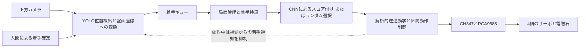

# ChessRobot

カメラによる盤面認識と電磁石による駒の搬送を組み合わせた、4自由度の中国象棋ロボット。

[简体中文](README.md) · [English](README_EN.md) · **日本語**

**詳細を読む：**[視覚とアルゴリズム](docs/technical-notes.ja.md#vision-history) · [数学モデル](docs/technical-notes.ja.md#mathematical-models) · [実機ギャラリー](docs/technical-notes.ja.md#hardware-gallery) · [セットアップ](docs/setup.ja.md)

ChessRobot（「智弈·灵手」）は、4名のチームで開発した学部のロボティクス授業プロジェクトです。上方カメラで人間の着手を検出し、ソフトウェア上の盤面から応手を選択して、4関節アームが磁性体の駒を搬送します。卓上環境で、視覚認識、局面管理、実機動作を連携させることに取り組みました。

授業用の試作機は**人間による着手確定**を用います。視覚処理は、円検出と文字分類から、YOLOによる位置検出と時系列安定化へ発展しました。任意局面の認識を目指し、盤面の自動補正と交点ごとの分類を組み合わせる第4世代を開発中です。


[実機デモ動画を見る](https://www.bilibili.com/video/BV1aXLn6HEQd)。授業用試作機の記録であり、第4世代の実機統合や一般的な認識精度を示す評価ではありません。

## システム構成



画像処理と全体の制御はWindows PC上で実行します。CH347 USBブリッジを介してPCA9685サーボドライバとリレーを制御します。USBカメラで35 × 35 cmのベージュ色の軟質盤を撮影し、直径約30 mmの手作り磁性駒32個を使用します。機構寸法、校正値、補償係数は、この試作機に合わせた値です。

## 主な設計と実装

**視覚とデータ。** 4点のホモグラフィから、検出した駒の中心を10 × 9の盤面に対応付けます。ROIマスク、局所コントラスト補正、中心座標の平滑化、追跡履歴の多数決で、背景や検出の揺らぎに対処します。駒の種類は初期配置と着手履歴で維持し、現在の検出器が各駒の漢字を個別に認識する構成ではありません。人間が着手後にSpaceを押し、その時点の盤面を確定します。

**運動制御。** 幾何学的な解析逆運動学で目標位置から4関節の指令を求め、横方向、半径方向、高さ方向の経験的補償を適用します。垂直吸着、盤面上方8 mmの接近区間、安全高さでの移送を組み合わせ、隣接駒との接触を低減します。直交座標の補間指令は公称50 Hzで生成しますが、実際の周期はホストとハードウェアに依存します。現在のプログラムは関節位置や実際の着地点を測定して動作を補正する閉ループを持ちません。

**局面管理と連携。** ルールモジュールは盤面を保持し、駒の移動条件を検証して候補手を列挙します。PyTorch CNNで8,100通りの始点・終点の組合せにスコアを付け、ルールモジュールが返した候補から選択します。`game/aaa.pth`がない場合は候補をランダムに選びます。全体の制御はキューで視覚と動作を連携させ、アームの動作中は視覚による着手通知を抑制します。現在のルール実装は競技用の完全な裁定システムではありません。

## 視覚処理の4世代の変遷

| 世代 | 方法と取り組み | 得られた知見と状態 |
| :--- | :--- | :--- |
| **第1世代：円検出と文字分類** | Hough円検出、色解析、合成文字画像で学習したグレースケールResNet-18。 | 過去の試作。照明、小さな文字画像、合成画像と実画像の差が認識を制限。 |
| **第2世代：多クラスYOLO** | 実画像の収集、手動アノテーション、14種類の駒に対する微調整。チーム記録では旧緑色盤500枚と、ベージュ色盤への変更後120枚。 | 過去の実験。盤の変更によるドメインシフトと類似文字の混同が課題。 |
| **第3世代：位置検出と状態追跡** | 単一クラスの位置検出、ホモグラフィ、追跡の安定化、人間の確定操作後の盤面差分。 | 現在の実機エントリーポイント。授業のデモに使用し、標準初期配置と手動確定に依存。 |
| **第4世代：補正後の盤面分類** | 4隅の姿勢推定、透視変換、合成盤面データ、Swinによる90交点の16状態分類。 | 開発中。専用データでの学習、評価、実機統合は今後の工程。このロボットでの精度値は掲載していません。 |

局所的な文字認識から、構造を持つ盤面全体の推定へ移行することが主な方針です。第3世代は実機デモの成立を優先しました。第4世代では駒の種類を直接復元し、中盤・終盤の任意配置に対応することを目指します。現行コード、過去の実験、新しい開発方針の関係は[技術ノート](docs/technical-notes.ja.md)にまとめています。

## チームの担当

| メンバー | 主担当 | 貢献内容 |
| :--- | :--- | :--- |
| **田峻硕 / Tian Junshuo** | リーダー、機構と運動制御 | アーム組立、ハードウェアドライバ、逆運動学、駒の把持と移送制御。 |
| **刘超然 / Chaoran Liu** | 視覚認識 | 実画像の収集とアノテーションを単独で担当。視覚処理の実験・改良、盤と磁性駒の製作、GUI試作、運動補償のパラメータ調整への協力、第4世代の開発。 |
| **张子琛 / Zichen Zhang** | ルールと着手選択 | 盤面表現、駒の移動規則、PyTorchによる着手選択モジュール。 |
| **邢义龙 / Yilong Xing** | 統合と治具 | 配線、電源分配、電磁石の取付治具、ハードウェア統合の支援。 |

報告書、スライド、口頭発表は4名で分担しました。担当の記載により、個人の作業とチーム全体の成果を区別しています。

## 検証結果と現在の対応範囲

| 根拠 | 観察結果 | 適用範囲 |
| :--- | :--- | :--- |
| チーム記録の配置試験 | **連続20手中18回で、駒が目標交点の中心を覆いました。** 2回はずれがありました。 | この小規模試験の中心被覆率は90%。mm単位の位置誤差、認識精度、対局全体の成功率とは異なる指標です。 |
| 実機動画 | 電磁吸着、移送、配置、待機位置への復帰。 | 授業用試作機の記録。条件を統制した認識評価ではありません。 |
| 視覚データの準備 | チーム記録では2種類の盤で合計620枚の実画像をアノテーション。 | データ準備の記録であり、モデル精度を示すものではありません。全学習画像は同梱していません。 |
| 第4世代の認識 | 開発方法と目標を記載。 | このロボット上の独立した実測値は未掲載です。 |

現在は4点校正、必要に応じた手動の向き指定、着手の確定操作が必要です。駒取りで追跡IDが混同する場合があります。色に基づく自動方向判定には実装上の問題があり、GUIも一部インターフェースの統合が必要です。デモ機と現行設定の違いを含め、[技術ノート](docs/technical-notes.ja.md)に説明しています。

## クイックスタート

実機のエントリーポイントはWindows 10/11、64-bit Python 3.10以上、CUDA対応のPyTorch環境、接続済みの実機を前提とします。`requirements.txt`は依存関係の下限を示すもので、動作検証済みの環境を固定するファイルではありません。

```powershell
git clone https://github.com/TJS-Git-Hub/ChessRobot.git
cd ChessRobot
python -m pip install -r requirements.txt
```

WCHドライバと`CH347DLLA64.DLL`を用意し、接続先と校正値を確認します。検出器は処理に合う`recognition/models/best.pt`、任意の着手選択モデルは`game/aaa.pth`に配置します。ファイル名だけではモデルのクラスや学習履歴を判断できません。

```powershell
python main.py
```

コントローラの初期化でアームが待機位置へ動きます。配線と動作範囲を確認してから実行してください。校正、キー操作、GUIの状態、外部ファイル、トラブル対応は[セットアップガイド](docs/setup.ja.md)を参照してください。

## 今後の開発とドキュメント

- **視覚：**本機の駒画像と空盤画像を準備し、補正後の盤面分類器を学習・評価して、実機の状態更新に接続します。駒取り、部分遮蔽、交点からのずれ、終盤を評価に含めます。
- **運動：**到達可能範囲の計算と実際の校正値を一致させ、盤面の各領域で配置試験を繰り返し、滑らかな加減速を検討します。
- **着手選択と統合：**移動制約と重みの読込みを検証し、GUIのインターフェースを補完します。今後の着手選択の改良は基準方式との比較で評価します。

[技術ノート](docs/technical-notes.ja.md)ではアルゴリズム、コード、評価、開発状況を扱い、[セットアップガイド](docs/setup.ja.md)では環境と操作を扱います。各文書には中・英・日の切替リンクがあります。

本リポジトリのコードは[MITライセンス](LICENSE)で公開しています。Ultralytics YOLO、OpenCV、PyTorch、PyQt5、WCHのハードウェアインターフェースを使用します。第4世代の検討ではOpenMMLabと既存の中国象棋認識実装も参考にしており、技術ノートに出典を記載しています。第三者のコンポーネントにはそれぞれのライセンスが適用されます。
