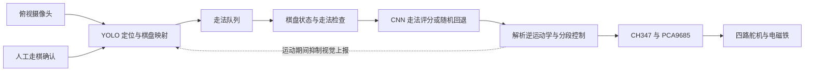

# ChessRobot

基于机器视觉与电磁抓放的四自由度中国象棋机器人。

**简体中文** · [English](README.md) · [日本語](README_JA.md)

**深入阅读：** [视觉感知](docs/technical-notes.zh-CN.md#vision-history) · [运动控制](docs/technical-notes.zh-CN.md#motion-hardware) · [棋局决策](docs/technical-notes.zh-CN.md#game-decision) · [数学模型](docs/technical-notes.zh-CN.md#mathematical-models) · [实机图集](docs/technical-notes.zh-CN.md#hardware-gallery) · [部署操作](docs/setup.zh-CN.md)

ChessRobot，又名“智弈·灵手”，是由四人团队完成的本科机器人课程项目。俯视摄像头检测人类走棋，软件棋盘选择应手，四关节机械臂通过电磁铁搬运棋子。项目探索了视觉感知、棋局状态与实体运动在桌面场景中的协同。

课程原型采用**人工确认走棋**。视觉方案从霍夫圆与字符分类逐步演进为 YOLO 定位和时序稳定流程；结合棋盘自动校正与网格分类的第四代方案正在开发，目标是识别任意中残局。


[观看完整实机演示](https://www.bilibili.com/video/BV1aXLn6HEQd)：课程原型的电磁抓放与走棋动作。

## 系统架构



图像处理和调度运行于 Windows PC。CH347 USB 桥接芯片连接 PCA9685 舵机驱动板及继电器控制接口。USB 摄像头观察 35 × 35 cm 米黄色软质棋盘，配合 32 枚直径约 30 mm 的手工导磁棋子。几何参数、标定值和补偿系数均针对这套原型硬件。

## 三大模块与工程设计

### 视觉感知：从字符识别到结构化盘面

视觉模块把相机图像转为棋盘上的位置变化。当前整机流程使用单类 YOLO 定位，通过四点单应性映射到 10 × 9 棋盘；ROI、CLAHE、中心点平滑、轨迹能量与历史投票共同处理背景干扰和检测波动。棋子身份由标准开局及走法历史维持，人类走棋后按空格键确认盘面。

下面四代是解决不同瓶颈的研发演进，第三代为当前整机入口，第四代为后续升级。

| 阶段 | 方法与工作 | 主要发现及状态 |
| :--- | :--- | :--- |
| **第一代：圆检测与字符分类** | 霍夫圆定位、颜色分析，以及使用合成字模训练的灰度 ResNet-18 字符分类。 | 历史原型。光照、字符裁剪分辨率及合成到真实图像的差异限制了实机识别。 |
| **第二代：多类别 YOLO** | 实拍采集、手工标注与 14 类棋子检测微调。团队记录包括原绿色棋盘约 500 张、更换米色棋盘后约 120 张图像。 | 历史实验。棋盘更换带来背景域变化，相似汉字仍难稳定区分。 |
| **第三代：定位与状态跟踪** | 单类棋子定位、单应性映射、轨迹稳定与人工确认后的盘面差分。 | 当前整机入口使用的流程。完成课程演示，依赖标准开局初始化和人工确认。 |
| **第四代：校正后的网格分类** | 四角点姿态估计、透视归一化、合成棋盘数据及 Swin 网络，对 90 个交点进行 16 状态分类。 | 开发中。项目专用训练、评估及整机集成仍是后续节点，本页不报告该方案在本机器上的准确率。 |

[视觉算法、数据与训练记录](docs/technical-notes.zh-CN.md#vision-history) · [第三代机制清单](docs/technical-notes.zh-CN.md#vision-generation-3)

### 运动控制：从棋盘交点到电磁抓放

运动模块将走法的起终点转换为机械臂坐标，协调四关节与电磁铁执行移位和吃子。

- **坐标与逆解：** 按格距、河界和棋盘偏置生成毫米坐标，以几何解析逆运动学求肩肘角，并保持末端朝下。
- **落点补偿：** 在逆解前加入横向比例、径向及随伸展距离变化的高度经验补偿，针对本套硬件的落点偏移进行调参。
- **抓放与转移：** 在安全高度横向移动，靠近棋盘时经过 8 mm 悬停点再缓慢垂直接近；吃子先移走目标棋子，再移动己方棋子。
- **插补与驱动：** 笛卡尔航路点按名义 50 Hz 插补，经过关节角—脉宽映射，由 CH347 与 PCA9685 驱动舵机，GPIO 控制电磁铁继电器。

当前采用预设动作序列与经验补偿，没有关节位置或落点测量反馈。[运动设计、标定参数与公式](docs/technical-notes.zh-CN.md#motion-hardware)

### 棋局决策：规则候选与神经网络评分

决策模块在软件棋盘上维护局面，将相机检测到的走棋转换为机器人应手。

- **棋盘与规则：** 以 10 × 9 棋盘存储双方棋子，实现马腿、象眼、河界、九宫及路径阻挡等运动约束，并枚举候选走法。
- **局面与动作编码：** 将红黑各七类棋子编码为 14 × 10 × 9 张量，将 90 个起点与 90 个终点映射到 8,100 维动作空间。
- **走法选择：** PyTorch CNN 为动作评分，在规则模块返回的候选中取最高分；当前入口依赖 `game/aaa.pth`，缺少时随机选择候选。

历史决策脚本还包含从棋谱构造“局面—走法”样本的监督学习流程。技术说明区分历史训练与当前推理，并说明规则覆盖范围。[决策网络、训练流程与集成](docs/technical-notes.zh-CN.md#game-decision)

## 三个模块如何协同

1. **感知与确认：** 视觉线程持续采集；人类确认走棋后，盘面差分产生起终点并进入走法队列。
2. **状态与决策：** 主线程转换坐标、检查并更新人类走法，再由规则模块和决策网络选择机器人应手。
3. **实体执行：** 先校验机器人走法并抑制视觉上报，再执行移位或吃子；动作指令序列成功返回后才更新软件棋盘与棋子数量。失败时停止并要求人工核对实物。
4. **下一回合：** 动作序列返回后，更新预期棋子数量并重建视觉基准，恢复等待人类走棋。

这里的协同依靠软件状态和指令调度；实体落子成功与软件状态一致性仍需通过实机验证。[调度与验证边界](docs/technical-notes.zh-CN.md#system-coordination)

## 团队贡献

| 成员 | 主要职责 | 工作内容 |
| :--- | :--- | :--- |
| **田峻硕 / Tian Junshuo** | 组长、机械与运动控制 | 机械臂装配、底层驱动、逆运动学及抓放转移控制。 |
| **刘超然 / Chaoran Liu** | 视觉感知 | 独立完成视觉实拍数据采集与标注；主导视觉试验与迭代，制作棋盘及导磁棋子，开发 GUI 原型，协同调试运动补偿参数，并推进第四代视觉方案。 |
| **张子琛 / Zichen Zhang** | 规则与走棋决策 | 棋盘表示、棋子运动规则及 PyTorch 走法选择模块。 |
| **邢艺龙 / Yilong Xing** | 系统集成与工装 | 电气布线、供电分配、末端执行器夹具及硬件联调支持。 |

项目报告、演示文稿和答辩汇报由四人分工完成。模块分工用于说明个人贡献与团队整机成果之间的关系。

## 验证结果与当前范围

| 依据 | 观察结果 | 适用范围 |
| :--- | :--- | :--- |
| 团队记录的落子试验 | **连续 20 步走棋中，18 次棋子覆盖目标交叉中心点**，2 次存在偏移。 | 本次小样本中心覆盖率为 90%；不等同于毫米级位置误差、视觉准确率或整场对局成功率。 |
| 实机演示视频 | 展示电磁吸取、转移、放置与复位动作。 | 记录课程原型，未构成受控的视觉识别评测。 |
| 视觉数据采集 | 团队记录共 620 张标注实拍图，包含两种棋盘背景。 | 用于说明数据准备工作，不代表模型准确率；完整训练原图未随仓库发布。 |
| 第四代识别 | 已说明开发方法与目标。 | 暂不报告该方案在本机器人上的独立实测指标。 |

当前课程原型依赖标准开局、四点标定、手动朝向选择及人工走棋确认。吃子跟踪、GUI 接口、可达性和动作结果处理的具体问题，集中记录于[当前实现与复现边界](docs/technical-notes.zh-CN.md#validation)。

## 快速开始

整机入口面向 Windows 10/11、64 位 Python 3.10+、支持 CUDA 的 PyTorch 环境与已连接的实体硬件。`requirements.txt` 给出依赖版本下限，并非经过锁定验证的完整环境。

```powershell
git clone https://github.com/TJS-Git-Hub/ChessRobot.git
cd ChessRobot
python -m pip install -r requirements.txt
```

准备 WCH 驱动与 `CH347DLLA64.DLL`，核对设备和标定参数，并确认 `recognition/models/best.pt` 与检测流程匹配。可选决策权重路径为 `game/aaa.pth`。

```powershell
python main.py
```

控制器初始化会驱动机械臂返回待命位置，应先完成接线和运动空间检查。标定、按键操作、GUI 状态、外部文件与故障排查见[部署与操作指南](docs/setup.zh-CN.md)。

## 后续开发与文档

- **视觉：** 准备本项目棋子切片与空盘图像，训练并评估校正后的网格分类器，再接入机器人状态更新；评测覆盖吃子、局部遮挡、偏离交点的棋子和残局。
- **运动：** 使可达性计算与实际标定一致，开展覆盖不同棋盘区域的重复落子试验，并研究更平滑的加减速轨迹。
- **决策与集成：** 验证走法约束和权重加载行为，开展 GUI 实机联调与验收，并在明确基线下评估后续决策改进。

[技术说明](docs/technical-notes.zh-CN.md)记录算法、代码依据、结果与研发状态；[部署与操作指南](docs/setup.zh-CN.md)记录依赖及运行流程。两类文档均提供中、英、日语言切换。

仓库代码采用 [MIT 许可证](LICENSE)。项目使用 Ultralytics YOLO、OpenCV、PyTorch、PyQt5 与 WCH 硬件接口。第四代研究也参考 OpenMMLab 和相关中国象棋识别实现，具体来源列于技术说明；第三方组件各自遵循其许可证。

## 维护与离线验证

2026-10 维护修订：修复黑棋亮度比例、GUI 视频与元组棋盘显示；规则过滤增加己方将帅受攻击及将帅照面检查。动作段先做逆解预检，驱动失败向上传播，动作指令成功返回后才提交机器人软件走法；失败后停止并要求人工核对实物。软件停止不等于硬件断电。7 项离线回归测试通过，未连接相机、CH347 或机械臂，未重测历史成功率。

2026-10-24：移位前预检起点与终点的落点、8 mm悬停点和安全高度；吃子还预检弃子区及己方起点，已知不可达时在首次移动或吸取前拒绝。每段插补仍单独预检，未证明整条抓放路径无碰撞。9项离线回归通过；标定参数未改，11/90目标仍被当前IK拒绝，需实测后才能修正。
